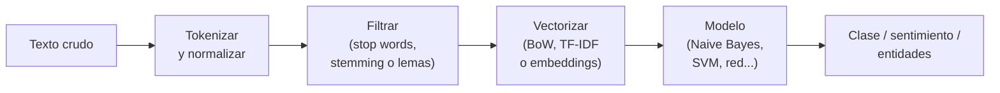
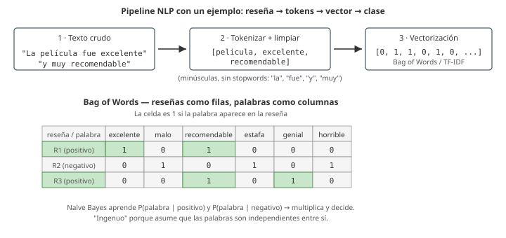

# 11 · Procesamiento de lenguaje natural (PLN / NLP)

> 🧩 **Guía de estudio para llegar a la clase con el tema masticado.**
> Fundamentada en las slides de la unidad *10 - Procesamiento de lenguaje natural* (Ing. Juan M. Rodríguez): *Aprendizaje Bayesiano*, *Análisis de Sentimientos* y *Extracción de Información*. También en las notebooks de la práctica *12 - Intro NLP* (introducción y clasificación con Naive Bayes y SentiWordNet).
> La teórica fue el **13/10** y la práctica el **22/10**. Los **embeddings** tienen su propia guía: la [14](14%20-%20Embeddings%20%28Word2Vec%29.md).

---

## 🎯 En una frase

El **procesamiento de lenguaje natural** enseña a la computadora a trabajar con **texto**. Para eso hay que convertirlo en **números**: primero con una **bolsa de palabras** o **TF-IDF**, después con **embeddings**. Sobre esa representación se arman tres tareas clásicas:
- **clasificar** textos, con **Naive Bayes**;
- detectar la **actitud** de quien escribe (**análisis de sentimientos**);
- sacar **datos estructurados** de un texto (**extracción de información**).

---

## 🧭 ¿Por qué importa / dónde encaja?

- **Aplica todo el ML de la materia a un dato nuevo:** el texto. Cada documento se vuelve un vector, y sobre ese vector se puede usar cualquier clasificador visto: Naive Bayes, regresión logística, SVM o K-NN.
- **Es la puerta de entrada a lo que sigue:**
  - los **embeddings** ([guía 14](14%20-%20Embeddings%20%28Word2Vec%29.md));
  - las **redes recurrentes** ([guía 15](15%20-%20Redes%20recurrentes%20%28RNN%2C%20LSTM%2C%20GRU%29.md));
  - los **Transformers** y los LLM ([guía 16](16%20-%20IA%20generativa%20-%20GAN%2C%20Deep%20Fakes%20y%20Transformers.md)).

---

## 💡 La idea con una analogía

Naive Bayes clasifica como un **detective que solo cuenta pistas**:
- **Qué hace:** en las críticas positivas aparece mucho "genial", y en las negativas, "aburrida". Ante una crítica nueva, multiplica cuánto apunta cada palabra a cada clase y se queda con la clase que gana.
- **Por qué es "ingenuo":** no le importa el **orden** ("no es buena" y "es buena, no" le dan igual) y trata cada pista como si no tuviera nada que ver con las demás.
- **Lo sorprendente:** igual acierta muchísimo.

---

## 🗺️ El recorrido de un texto

---

## 1️⃣ Del texto a los números (práctica *Intro NLP*)

### Preprocesamiento

| Paso | Qué hace | Ejemplo / herramienta |
| --- | --- | --- |
| **Tokenizar** | Partir el texto en **tokens** (más o menos, palabras), cortando por espacios y signos de puntuación | `nltk.word_tokenize`, el tokenizador de **spaCy**. En español, el "¿" complica a NLTK |
| **Normalizar** | Llevar variantes a una misma forma: minúsculas, sin tildes, sin espacios de más | `unidecode("fàntástiço")` → `fantastico` |
| **Stop words** | Sacar palabras muy frecuentes que casi no distinguen clases ("el", "de", "que") | Lista de NLTK o propia |
| **Stemming** | Cortar sufijos para quedarse con la raíz. Es **bruto**: "empathy" y "empathize" no quedan con la misma raíz | Stemmer de NLTK |
| **Lematización** | Llevar la palabra a su **forma canónica** (el lema): "corrían" → "correr". Más fina que el stemming | spaCy |
| **N-gramas** | Tomar grupos de N palabras para no perder nombres o expresiones compuestas ("La Rioja", "no me gustó") | `CountVectorizer(ngram_range=(1,2))` |
| **Subpalabras** | Lo que hacen los LLM: partir en **fragmentos frecuentes** (BPE, WordPiece). Resuelve palabras desconocidas y vocabularios gigantes | `tiktoken` (GPT) |

**Tareas que spaCy ya trae resueltas con modelos:**
- separar oraciones;
- **POS tags** (la función gramatical de cada palabra);
- **dependency parsing** (qué palabra depende de cuál);
- **NER** (reconocimiento de entidades).

### Bolsa de palabras (*Bag of Words*, BoW)

- **Qué es:** un documento se representa por **cuántas veces aparece cada palabra del vocabulario**.
- **Por qué "bolsa":** las palabras **no tienen orden** y **pueden repetirse**. No es una lista (que tiene orden) ni un conjunto (que no repite).
- **Por qué hace falta:** Bayes no sabe trabajar con cadenas de caracteres, solo con números.

**Ejemplo de la cátedra:**

| Doc | Texto | Vector BoW |
| --- | --- | --- |
| 1 | Que mala película | [1,1,1,0,0,0,0,0] |
| 2 | Que buena película | [1,0,1,1,0,0,0,0] |
| 3 | Odio esta película | [0,0,1,0,1,1,0,0] |
| 4 | Amo esta película. La Amo. | [0,0,1,0,0,1,**2**,1] |

Vocabulario = {Que, mala, película, buena, Odio, esta, Amo, la}, con |V| = 8.

**Cómo es esa matriz:**
- Se llama **matriz término-documento**: una fila por documento, una columna por término (`CountVectorizer` de scikit-learn).
- Es **dispersa** (*sparse*): casi todas las celdas son cero.
- Es **enorme**: |V| suele estar entre 10.000 y 50.000 palabras.

### TF-IDF

**El problema de contar:** las palabras que aparecen en **todos** los documentos tienen conteos altísimos, pero justamente por eso **no sirven para distinguir** un documento de otro.

TF-IDF combina dos ideas:
- **TF** (*term frequency*): qué tan frecuente es la palabra **en este documento**. tf(t,d) = f(t,d) / total de palabras de d.
- **IDF** (*inverse document frequency*): qué tan **rara** es en el corpus. idf(t) = log(N / df), donde N es la cantidad de documentos y df, en cuántos aparece *t*.
- **tf-idf = tf × idf.** Un valor **alto** quiere decir que la palabra aparece bastante en ese documento y en pocos de los demás.

> ✍️ **Mini cuenta** (con los 4 documentos de arriba y log natural):
> - "película" está en los 4 → idf = log(4/4) = **0**. Su peso queda en cero en todos: no distingue nada.
> - "Odio" está en 1 → idf = log(4/1) ≈ **1,39**. Pesa mucho en el documento 3.
>
> ⚠️ La notebook usa la variante log(N / (1 + df)), y `TfidfVectorizer` de scikit-learn usa por defecto ln((1+N)/(1+df)) + 1. La idea es la misma: **cuanto más común en el corpus, menos pesa**.

### Similitud coseno

- **Qué mide:** el **ángulo** entre dos vectores. cos(v, w) = (v · w) / (|v| · |w|).
- **Por qué no alcanza el producto punto:** favorece a los vectores **largos**, es decir, a los documentos largos o las palabras frecuentes. El coseno **normaliza** por la longitud.
- **Valores:** 1 = misma dirección, 0 = nada en común. Con conteos, no hay negativos.

> ✍️ **Ejemplo de la práctica** (Jurafsky, conteos de co-ocurrencia con los contextos *pie*, *data* y *computer*):
> - cherry = (442, 8, 2) · digital = (5, 1683, 1670) · information = (5, 3982, 3325).
> - cos(information, digital) ≈ **0,996**.
> - cos(information, cherry) ≈ **0,018**.
> - *Information* se parece a *digital* porque comparten contextos (*data*, *computer*).

### Ley de Zipf (práctica de Naive Bayes)

- **Qué dice:** la frecuencia de una palabra es **inversamente proporcional a su rango**. La 1.ª aparece el doble que la 2.ª y el triple que la 3.ª. En escala log-log se ve como una **recta de pendiente ≈ −1**.
- **Consecuencias para armar las features:**
  - **La cola larga:** son las palabras que aparecen una sola vez (en la práctica, ~35% del vocabulario). No alcanzan para estimar P(w|c) y solo meten ruido. Se podan con `min_df=5`.
  - **La cabeza:** son unas pocas palabras hiperfrecuentes que casi no distinguen clases. Son las **stop words**.

### Limitaciones de la bolsa de palabras

- **Pierde el orden:** "el gato comió al ratón" = "el ratón comió al gato".
- **Pierde el contexto:** "banco" de plaza = "banco" de plata.
- **Es enorme y dispersa,** y no sabe que "auto" y "vehículo" se parecen.

Lo resuelven los **embeddings** ([guía 14](14%20-%20Embeddings%20%28Word2Vec%29.md)) y los **Transformers** ([guía 16](16%20-%20IA%20generativa%20-%20GAN%2C%20Deep%20Fakes%20y%20Transformers.md)).

---

## 2️⃣ Clasificación de textos con Naive Bayes (slides *Aprendizaje Bayesiano*)

### Qué es clasificar textos

- **Para qué sirve:** asignar **automáticamente** una categoría a un texto.
- **Ejemplos:**
  - spam / no spam;
  - el autor de un texto, su sexo o su edad;
  - el idioma;
  - el sentimiento.
- **Entradas:** un documento *d* y un conjunto fijo de clases C = {c₁, …, cⱼ}.
- **Salida:** una clase *c* ∈ C.

**Dos maneras de hacerlo:**

| Método | Cómo | Pro | Contra |
| --- | --- | --- | --- |
| **Reglas a mano** | "si el remitente está en una lista negra **o** el asunto dice *viagra* → SPAM" | La **precisión** puede ser muy alta | Construirlas y **mantenerlas** es caro |
| **Aprendizaje supervisado** | Se le da además un conjunto de documentos ya clasificados {(d₁,c₁), …, (dₙ,cⱼ)} y devuelve un **clasificador entrenado** d → c | Aprende solo | Necesita datos etiquetados |

Clasificadores posibles: **Naive Bayes**, regresión logística, SVM y K-NN.

### La idea de Naive Bayes 🔴

1. **La pregunta:** ¿cuál es la probabilidad de que el documento *d* sea de la clase *c*? Es **P(c | d)**.
2. **Bayes:** P(c | d) = P(d | c) · P(c) / P(d).
3. **Me quedo con la clase de máxima probabilidad a posteriori** (MAP): c_MAP = argmax P(c | d).
4. **P(d) es igual para todas las clases**, así que se saca: c_MAP = argmax P(d | c) · P(c).
5. **El documento se ve como una bolsa de palabras x₁…xₙ** y se asume independencia. Entonces:

> **c_MAP = argmax_c  P(c) · ∏ P(xᵢ | c)**

**Los dos supuestos "ingenuos"** (*naïve*):
1. **No importa el orden de las palabras.** "Él es una buena persona y no un violento" = "Él es un violento y no una buena persona".
2. **Las palabras son independientes entre sí dada la clase.** Tampoco es cierto: después de "Buenos" casi seguro viene "Aires", y después de "Nueva", "York".

Los dos son **falsos**, pero simplifican muchísimo las cuentas y los resultados siguen siendo muy buenos.

### Cómo se entrena: dos estimaciones sobre el conjunto de entrenamiento T

| Qué | Fórmula |
| --- | --- |
| **Probabilidad de la clase** | P(c) = documentos de clase *c* en T / documentos totales en T |
| **Probabilidad de la palabra dada la clase** | P(wᵢ \| c) = veces que aparece wᵢ en los documentos de *c* / total de palabras de los documentos de *c* |

### Laplace smoothing (*add-one*) 🔴

- **El problema:** si en la prueba aparece una palabra que **nunca** estuvo en una clase durante el entrenamiento (por ejemplo, "fantástica"), su conteo es 0. Como todo se **multiplica**, la probabilidad de la clase entera queda en **0**.
- **La solución:** sumar 1 a cada conteo, y sumar |V| (el tamaño del vocabulario) al denominador para que siga normalizado.

> **P(wᵢ | c) = (cantidad(wᵢ, c) + 1) / (total de palabras de c + |V|)**

### ✍️ El ejemplo paso a paso de la cátedra

| Corpus | Doc | Palabras | Clase |
| --- | --- | --- | --- |
| Entrenamiento | 1 | Chileno Santiago Chileno | C |
| | 2 | Chileno Chileno Valparaíso | C |
| | 3 | Chileno Allende | C |
| | 4 | Montevideo Uruguay Chileno | U |
| Prueba | 5 | Chileno Chileno Chileno Montevideo Uruguay | **?** |

**Datos de partida:**
- P(C) = 3/4 · P(U) = 1/4.
- **|V| = 6:** Chileno, Santiago, Valparaíso, Allende, Montevideo y Uruguay.
- **Palabras por clase:** C tiene 8 (3+3+2) y U tiene 3.

**Probabilidades por palabra, con Laplace:**

| | Clase C | Clase U |
| --- | --- | --- |
| P(Chileno \| ·) | (5+1)/(8+6) = **3/7** | (1+1)/(3+6) = **2/9** |
| P(Montevideo \| ·) | (0+1)/(8+6) = **1/14** | (1+1)/(3+6) = **2/9** |
| P(Uruguay \| ·) | (0+1)/(8+6) = **1/14** | (1+1)/(3+6) = **2/9** |

**Con el documento 5** ("Chileno" tres veces, Montevideo y Uruguay):
- P(C | d5) ∝ 3/4 · (3/7)³ · (1/14)² ≈ **0,0003**
- P(U | d5) ∝ 1/4 · (2/9)⁵ ≈ **0,0001**
- **Gana C (Chile)**: las tres apariciones de "Chileno" pesan más que "Montevideo" y "Uruguay".

> ✍️ **Para practicar** (mismo método, armado para la guía):
> - **Entrenamiento:** d1 = "buena película buena" (P), d2 = "mala trama" (N), d3 = "buena actuación" (P).
> - **Prueba:** "buena trama".
>
> **Datos de partida:**
> - |V| = 5;
> - P(P) = 2/3 y P(N) = 1/3;
> - la clase P tiene 5 palabras y la N, 2.
>
> **Cuentas:**
> - P(P | d) ∝ 2/3 · (3+1)/(5+5) · (0+1)/(5+5) = 2/3 · 0,4 · 0,1 ≈ **0,0267**
> - P(N | d) ∝ 1/3 · (0+1)/(2+5) · (1+1)/(2+5) = 1/3 · 1/7 · 2/7 ≈ **0,0136**
> - **Gana P**: "buena" pesa más que "trama".

### Variante binarizada (o booleana) 🟠

- **Qué cambia:** antes de contar se **eliminan las palabras repetidas dentro de cada documento**. Importa si la palabra **aparece**, no cuántas veces.
- **Resultado:** en general **da mejores resultados** que contar todas las ocurrencias. La vieron en *Análisis de Sentimientos*.

### Redes bayesianas

- **Qué son:** un **grafo acíclico dirigido**:
  - los nodos son **variables**;
  - las aristas, **dependencias condicionales**;
  - cada nodo tiene su **tabla de probabilidades condicionales**.
- **Naive Bayes como red bayesiana:** cada palabra depende solo de la clase y **no hay aristas entre palabras**.
- **Ejemplo de la alarma:**
  - la alarma se activa por un **robo** o por un **terremoto**;
  - los vecinos Juan y María **llaman** si la escuchan.

  Permiten **inferencia**: P(Robo | Juan llama, María llama) = ⟨0,284; 0,716⟩. O sea, aunque los dos llamen, la probabilidad de robo es 28,4%.
- **Contra Naive Bayes:**
  - las redes bayesianas hacen inferencias **más precisas**, pero son **más difíciles de construir y mantener**;
  - Naive Bayes es **muy rápido**, ocupa poco, es **robusto ante palabras irrelevantes** y es muy bueno cuando hay muchas características importantes;
  - si las palabras fueran de verdad independientes, Naive Bayes sería **óptimo**.

### 🧪 En la práctica (notebook *Naive Bayes y SentiWordNet*)

- **Features:** `CountVectorizer` con `min_df` y stop words, probando **n-gramas** y otros parámetros.
- **Modelo:** `MultinomialNB`, comparado contra un **`DummyClassifier`**:
  - `most_frequent` predice siempre la clase mayoritaria;
  - `stratified` predice al azar con las proporciones de entrenamiento;
  - `uniform` predice al azar parejo.

  **Si el modelo no le gana al dummy, no aprendió nada.** Un número de performance no significa nada en abstracto.
- **Normalización:** con **stemming** y lematización, para ver si mejora la performance.
- **Enfoque léxico (SentiWordNet):**
  - es **no supervisado**: no usa las etiquetas;
  - cada palabra busca su *synset* de WordNet y suma su `pos_score` y su `neg_score`;
  - el puntaje final es positivo − negativo, y si supera un umbral, la crítica es "pos".

---

## 3️⃣ Análisis de sentimientos (slides *Análisis de Sentimientos*)

### Qué es

- **Es una tarea de clasificación de textos:** "Decepcionante" → negativo; "Personajes memorables" → positivo.
- **También se llama** extracción de opinión, minería de opiniones, minería de sentimientos o análisis de subjetividad.
- **Para qué se usa:**
  - si una crítica de película es positiva o negativa;
  - qué piensa la gente de un producto;
  - la confianza del consumidor (los tweets correlacionaron **0,804** con las encuestas de Gallup);
  - política;
  - predecir elecciones o el mercado ("la calma" en Twitter predecía el Dow Jones con **3 días** de anticipación).

### Qué detecta exactamente: actitudes 🔴

La **tipología de Scherer** distingue cinco estados afectivos:

| Estado | Qué es | Ejemplos |
| --- | --- | --- |
| Emoción | Respuesta **corta** a un estímulo | ira, tristeza, miedo |
| Estado de ánimo | Baja intensidad y **larga duración** | alegre, irritable |
| Postura interpersonal | Posición afectiva **hacia otra persona** en una interacción | distante, cálido |
| **Actitud** | **Preferencia o predisposición** hacia personas u objetos | simpatía, amor, odio, valoración |
| Rasgo de personalidad | Tendencia de comportamiento típica | nervioso, envidioso |

> 🔑 **El análisis de sentimientos detecta actitudes.** Una actitud completa tiene:
> - el **portador** (quién la tiene);
> - el **destinatario** (hacia qué o quién);
> - el **tipo** (simpatía, odio… o una polaridad positiva, negativa o neutral, con un peso);
> - el **texto** que la contiene.

**Tres niveles de dificultad:**
1. **Simple:** ¿el texto es positivo o negativo?
2. **Más compleja:** puntuar la actitud de 1 a 5.
3. **Avanzada:** detectar el portador, el destinatario y el tipo de actitud.

### Algoritmo de Pang y Lee (polaridad de críticas)

**Los pasos:**
1. **Tokenizar.** Hay que resolver:
   - los tags HTML;
   - las marcas de Twitter (@usuarios, #hashtags);
   - las **mayúsculas** (conviene conservarlas);
   - teléfonos y fechas;
   - los **emoticones**, muy útiles para sentimientos.
2. **Extraer características.** Hay dos decisiones:
   - **¿Todas las palabras o solo los adjetivos?** En IMDB funcionó mejor **usar todas**: sustantivos y verbos también traen juicios de valor.
   - **La negación:** se marcan con `NO_` las palabras entre la negación y el siguiente signo de puntuación. "No me gustó esta película, pero…" → "No **NO_me NO_gustó NO_esta NO_película** pero…".
3. **Clasificar** con **Naive Bayes** (mejor en su versión **binarizada**), MaxEnt o SVM. Se elige el modelo que maximice precision, recall y F1.

**Lo que le cuesta:**
- **Sutilezas:** "si es su fragancia favorita, úsela en su casa y cierre bien las ventanas".
- **Expectativas frustradas:** "debería ser excelente porque tiene grandes actores…, sin embargo es terriblemente aburrida".

### Lexicones de sentimiento

Son listas de palabras ya clasificadas por polaridad:

| Lexicón | Qué tiene |
| --- | --- |
| **General Inquirer** | 1915 positivas, 2291 negativas, más categorías como fuerte/débil y activa/pasiva. En inglés, gratis para investigación |
| **LIWC** | 2300 palabras, más de 70 clases. **Soporta español**. Es **pago** |
| **MPQA** | 2718 positivas, 4912 negativas, con **intensidad** (fuerte/débil). Licencia GPL |
| **Bing Liu** | 2006 positivas, 4783 negativas. Solo positiva/negativa |
| **SentiWordNet** | Basado en **WordNet**. Cada palabra tiene un puntaje positivo, negativo **y objetivo**, que pueden coexistir. Creative Commons |

Los lexicones **no siempre coinciden** entre sí.

**Cómo ampliar un lexicón propio** (con un puñado de ejemplos y algunas reglas):
- **Hatzivassiloglou y McKeown:**
  - adjetivos unidos por "**y**" tienen la **misma** polaridad ("justo y legítimo");
  - unidos por "**pero**", polaridad **opuesta** ("justo pero brutal").

  Los pasos:
  1. Arrancaron con 1336 adjetivos clasificados a mano.
  2. Buscaron "was ⟨adjetivo⟩ and" y "… but" para encontrar adjetivos nuevos.
  3. Armaron un grafo de palabras similares y opuestas.
  4. Lo partieron en dos grupos.

  ⚠️ Mete errores: hace falta **revisar a mano**.
- **Turney** (polaridad de **frases**):
  1. Extraer frases de las críticas.
  2. Calcular la polaridad de cada frase.
  3. **Puntuar la crítica** con el promedio de sus frases.

  La polaridad sale de qué tan seguido aparece la frase **cerca de** "excelente" contra "pobre", con **PMI** (*pointwise mutual information*):
  - **PMI(x, y) = log₂ [ P(x,y) / (P(x)·P(y)) ]**: cuánto más juntas aparecen x e y de lo que aparecerían si fueran independientes.
  - **Polaridad(frase) = PMI(frase, "excelente") − PMI(frase, "pobre")** = log₂ [ #(frase NEAR excelente) · #(pobre) / (#(frase NEAR pobre) · #(excelente)) ].

  **Resultado:** 74% de exactitud promedio sobre 410 opiniones. Rindió 66% en películas y 80–84% en bancos y autos.

### Aspectos (más de un sentimiento en la misma frase)

- **El problema:** "¡La comida era excelente **pero** el servicio pésimo!".
- **El método de Hu y Liu** encuentra los **aspectos** (objetos de sentimiento) en dos pasos:
  - **Frecuencia:** las frases que más se repiten en las críticas de un lugar ("tacos de pescado").
  - **Reglas:** filtrarlas, por ejemplo quedándose con las que aparecen después de una palabra de sentimiento ("¡geniales tacos de pescado!").
- **Corpus chicos:** se pueden etiquetar a mano aspectos conocidos (comida, decoración, servicio, precio) y entrenar un clasificador.
- **Clases desbalanceadas** 🟠:
  - no uses la precisión: usá **F-score**;
  - las dos soluciones comunes son **muestrear parejo** o **penalizar más** los errores en la clase rara.

---

## 4️⃣ Extracción de información (slides *Extracción de Información*)

**El objetivo:** capturar las partes relevantes de un texto, muchas veces de varios documentos, y armar una representación **estructurada**, como una tupla de base de datos.

> "La empresa abrió su filial local en **2008** en **Puerto Madero**" → `SEDE("Google_Argentina", "Puerto Madero")` · `APERTURA_SEDE("Google_Argentina", "2008")`.

**Historia:**
- **1991:** DARPA busca llenar plantillas sobre terrorismo en América Latina (fechas, lugares, perpetradores, armas, víctimas).
- **Fines de los 90:** se pasa a otros dominios, con **reglas de patrones hechas a mano**.
- **Hoy:** métodos supervisados, auto-supervisados y **Open IE** (no supervisados, independientes del dominio, para la Web).

### NER: reconocimiento de nombres de entidades 🔴

- **Qué hace:** encuentra y clasifica las entidades de un texto. Por ejemplo: *Ready Player One* → libro · Ernest Cline → persona · España → lugar · 2011 → fecha · Ediciones B → editorial · OASIS → otro.
- **Para qué sirve:**
  - índices y enlaces;
  - el **destinatario** en análisis de sentimientos;
  - extracción de información;
  - *question answering*.
- **El error doble:** si en "First Bank of Chicago" se reconoce solo "Bank of Chicago", **falta** una entidad **y sobra** otra que no existe.

**Pasos del entrenamiento:**
1. Documentos representativos del dominio.
2. Etiquetar **cada token** con su clase (o "O" = otra).
3. Definir características.
4. Entrenar un **clasificador secuencial**.

**Codificación de etiquetas:**

| Token | IO | **IOB** |
| --- | --- | --- |
| Fred | PER | **B**-PER |
| showed | O | O |
| Sue | PER | **B**-PER |
| Mengqiu | PER | **B**-PER |
| Huang | PER | **I**-PER |
| 's | O | O |

> 🔑 Con **IO** no se puede saber dónde termina "Sue" y empieza "Mengqiu Huang": son tres PER seguidos. **IOB** marca el **comienzo** (B = *begin*) de cada entidad.

**Características que se usan:**
- **De la palabra:**
  - la palabra actual (¿está en mi diccionario?);
  - la anterior o la siguiente ("a las …" → hora; "en …" → lugar);
  - **substrings** ("-oxa" → droga; "-field" → lugar; ":" → película);
  - la **forma** (Xx-xxx → "Varicela-zóster"; XXXd → "CPA1").
- **Lingüísticas:** etiquetado gramatical (adjetivo + sustantivo + sustantivo → entidad).
- **De contexto:** las etiquetas vecinas (PERSONA + PERSONA + ? → probablemente PERSONA: "Juan Carlos Pérez").

**Inferencia:** greedy, beam, **Viterbi** y **CRF**.

### Extracción de relaciones

- **Ontología:** relaciones como **is-a** (hipónimo: jirafa es un rumiante, que es un mamífero) e **instance-of** (Buenos Aires es una ciudad).
- **Formas de construirla:**

| Método | Cómo | Pros / contras |
| --- | --- | --- |
| **Reglas a mano** (patrones de Hearst) | "Y como X", "X y otros Y", "Y incluyendo X", "Y, sobre todo X" → *países europeos, sobre todo Francia* | **Alta precisión** y adaptable al dominio, pero **muy bajo recall** y mucho trabajo pensar todos los patrones |
| **Supervisado** | Elegir relaciones y entidades → etiquetar el corpus → entrenar un clasificador (MaxEnt, Naive Bayes, SVM). Features: palabras y bigramas de las menciones, palabras entre ellas, **tipos de entidad** (Organización-Persona) y el **análisis sintáctico** (árbol de dependencias) | Preciso pero caro de etiquetar |
| **Auto-supervisado: bootstrap** | Con pares **semilla** conocidos, se buscan oraciones, se arman **patrones** con comodines y se buscan entidades nuevas. Se repite. *Borges está enterrado en Ginebra* → "X está enterrado en Y" | Escalable |
| **Distant supervision** | Bootstrap + supervisado: en vez de 5 semillas, usa **una base de datos grande** de tuplas (⟨Borges, Buenos Aires⟩ para "nació-en"), extrae patrones del corpus y **entrena un clasificador** | Usa muchos datos sin etiquetar y no necesita iterar |
| **No supervisado (Open IE)** | KnowItAll (2005), **TextRunner** (2007): una sola pasada y extrae relaciones **no definidas de antemano** | Independiente del dominio y escalable |

**Ejemplos que se ven en la cursada:**
- **DIPRE** (Brin, 1998):
  - partió de 5 semillas autor → libro;
  - con *The Comedy of Errors, by William Shakespeare, was…* aprendió el patrón "X, by Y,".
- **ECMes** (2021, en español):
  - usa el parser de Stanford;
  - de "Albert Einstein, quien nació en Ulm, ganó el Premio Nobel" saca (Albert Einstein; nació en; Ulm) y (Albert Einstein; ganó el; Premio Nobel).
- **Google Knowledge Graph.**

**Métricas:** precisión = extracciones correctas / total de extracciones · recall = extracciones correctas / relaciones existentes · F1.

---

## ⚠️ Ojo con las slides

| Dónde | Qué dice | Lo correcto |
| --- | --- | --- |
| *Extracción de Información*, slide 50 | "Algoritmo de **Dripe**" | Es **DIPRE** (*Dual Iterative Pattern Relation Expansion*, Sergey Brin, 1998) |
| *Extracción de Información*, slide 46 | Recall = "exhaustividad o **exactitud**" | Recall es **exhaustividad** (sensibilidad). **Exactitud** es *accuracy*, otra métrica |
| *Aprendizaje Bayesiano*, slide 29 | Escribe el denominador como "|V+1|" | Es **\|V\| + 1**: al vocabulario se le suma **una** palabra nueva ("fantástica") |
| Notebook *Intro NLP* | idf = log(N / (1 + df)) | Es **una** de las variantes. La clásica es log(N / df), y scikit-learn usa otra suavizada. En el examen, aclará cuál usás |

---

## ❓ Preguntas para autoevaluarte

1. ¿Por qué hay que **vectorizar** un texto? ¿Qué es una **bolsa de palabras** y por qué es "bolsa" y no "lista" ni "conjunto"?
2. ¿Qué problema de contar palabras resuelve **TF-IDF**? ¿Qué peso le da a una palabra que aparece en **todos** los documentos?
3. ¿Por qué se usa el **coseno** y no el producto punto para comparar documentos?
4. Escribí la fórmula de **Naive Bayes** para clasificar un documento. ¿Por qué se puede sacar P(d)?
5. ¿Cuáles son los **dos supuestos** "ingenuos"? ¿Son ciertos? ¿Por qué igual funciona?
6. ¿Qué problema resuelve **Laplace smoothing**? Escribí la fórmula.
7. Resolvé el ejemplo de Chile y Uruguay **sin mirar**.
8. ¿Qué es la variante **binarizada** y por qué suele andar mejor?
9. Según Scherer, ¿qué detecta en realidad el análisis de sentimientos? ¿Qué partes tiene una **actitud**?
10. ¿Cómo maneja Pang y Lee la **negación**? ¿Conviene usar solo adjetivos?
11. Explicá cómo **amplía un lexicón** el algoritmo de Hatzivassiloglou y McKeown, y cómo calcula Turney la polaridad de una frase.
12. ¿Qué hacés si las críticas positivas y negativas están **desbalanceadas**?
13. ¿Qué es **NER**? ¿Para qué sirve la codificación **IOB** frente a la IO?
14. Compará **reglas a mano**, **bootstrap**, **distant supervision** y **Open IE** para extraer relaciones.
15. ¿Por qué hay que comparar el modelo contra un **DummyClassifier**?

---

## 📌 Qué prestar atención en la clase

- **Naive Bayes de punta a punta:** la fórmula, los supuestos, **Laplace** y el ejemplo numérico. Es lo más "de examen" de la unidad.
- **La negación** y la **variante binarizada** en análisis de sentimientos.
- **NER e IOB**, y los métodos para extraer relaciones (precisión vs. recall de cada uno).
- **Los límites de la bolsa de palabras:** de ahí se pasa a **embeddings** y redes.
- ⚠️ Con el cambio de fecha del parcial (al 29/10), esta unidad quedó **antes** del parcial. **Confirmá en clase si entra en el recuperatorio** (19/11).

---

⚙️ Guía fundamentada en las slides de la unidad *10 - Procesamiento de lenguaje natural* (Ing. Juan M. Rodríguez): *Aprendizaje Bayesiano*, *Análisis de Sentimientos* y *Extracción de Información*, y en las notebooks de la práctica *12 - Intro NLP* (Introducción; Clasificación de textos con Naive Bayes y SentiWordNet). Las cuentas de los ejemplos fueron verificadas.
