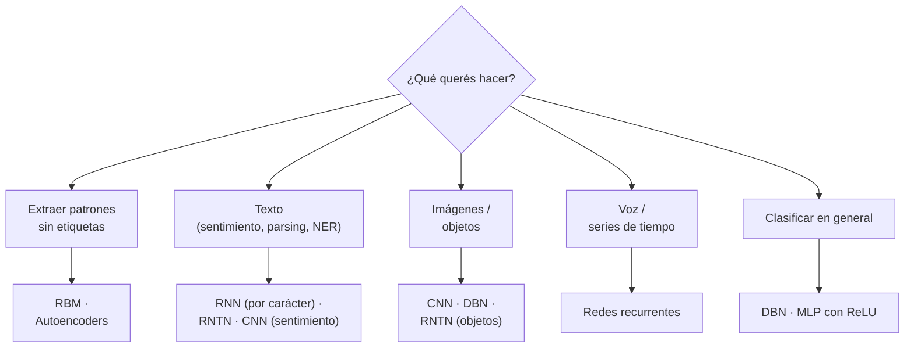
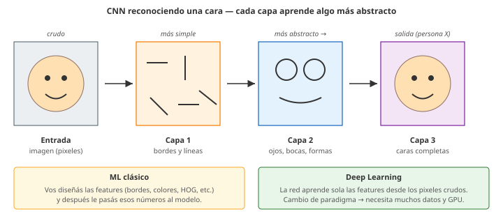

# 12 · Introducción a las redes de aprendizaje profundo (Deep Learning)

> 🧩 **Guía de estudio para llegar a la clase con el tema masticado.**
> Fundamentada en las slides de la unidad *11 - Deep Nets* (Dr. Ing. Juan M. Rodríguez): *Introducción a las redes de aprendizaje profundo* y el repaso de redes convolucionales y softmax de *Redes GAN*.
> Teórica del **martes 3/11**. Cada arquitectura grande tiene su guía:
> - recurrentes en la [15](15%20-%20Redes%20recurrentes%20%28RNN%2C%20LSTM%2C%20GRU%29.md);
> - GAN, deep fakes y Transformers en la [16](16%20-%20IA%20generativa%20-%20GAN%2C%20Deep%20Fakes%20y%20Transformers.md).

---

## 🎯 En una frase

Una **red profunda** es una red neuronal con **muchas capas** que aprende **representaciones cada vez más abstractas** de los datos. Tardaron casi 50 años en ser prácticas por el **desvanecimiento del gradiente** y el **costo de entrenarlas**, hasta que entre **2006 y 2007** Hinton, LeCun y Bengio encontraron cómo entrenarlas.

---

## 🧭 ¿Por qué importa / dónde encaja?

- **Extiende las redes superficiales** de la [guía 10](10%20-%20Redes%20neuronales%20%28perceptr%C3%B3n%2C%20MLP%2C%20backpropagation%2C%20SOM%29.md) (perceptrón, MLP, backpropagation): las redes de una o dos capas ocultas pasan a tener muchas.
- **Presenta el "zoológico" de arquitecturas** que se usa en el resto de la materia:
  - convolucionales para **imágenes**;
  - recurrentes para **secuencias**;
  - autoencoders y RBM para aprender **sin etiquetas**;
  - y, más adelante, GAN y Transformers.
- **En el cronograma sigue:** 10/11 recurrentes y generativas · 17/11 modelos preentrenados (YOLO, GAN, VQGAN) · 24/11 LLMs y RAG.

---

## 💡 La idea con una analogía

Una red profunda reconoce una cara como un **equipo de detectives en cadena**:
1. el primero solo ve **líneas y bordes**;
2. el segundo arma **ojos y narices**;
3. el tercero reconoce **una cara**;
4. el último dice **de quién es**.

Nadie le explica qué es un ojo: cada capa **lo descubre de los datos**. El problema histórico era que, con tantos detectives, el "reto" del jefe (el gradiente del error) **se perdía** antes de llegar al primero, que nunca aprendía.

---

## 🗺️ Qué red usar para qué (slides)

---

## 📊 Conceptos clave

### Por qué tardaron casi 50 años 🔴

| Problema | Qué pasa |
| --- | --- |
| **Tiempo de entrenamiento** | Entrenar una red profunda puede llevar **meses**. Con **GPU** modernas, menos de una semana (la slide compara 1 día con 8 meses) |
| **Desvanecimiento del gradiente** | Con backpropagation, el gradiente se va **achicando** capa a capa hacia atrás. Las **primeras capas casi no aprenden**, y son justamente las que detectan los patrones básicos |

**La solución llegó entre 2006 y 2007**, con tres papers de **Geoff Hinton** (el "padre del deep learning"), **Yann LeCun** y **Yoshua Bengio**.

### Las arquitecturas de la unidad

| Red | Idea | Cómo se entrena | Uso típico |
| --- | --- | --- | --- |
| **RBM** (*Restricted Boltzmann Machine*) | Dos capas (visible y oculta). Se pasa la entrada **hacia adelante**, se reconstruye **hacia atrás** y se compara | Ajusta pesos y bias con **divergencia KL** hasta que la reconstrucción se parezca a la entrada | Extraer patrones **sin etiquetas** |
| **DBN** (*Deep Belief Network*) | **Igual que un MLP**, pero entrenada distinto: una **pila de RBM**, entrenadas de a una | 1) **No supervisado**, capa por capa: cada capa aprende **la entrada entera**. 2) Un ajuste **supervisado** con **pocos** datos etiquetados | Clasificación, imágenes |
| **Autoencoder** | Aprende a **reproducir a la salida lo mismo que recibe** a la entrada. Tiene igual cantidad de neuronas de entrada y salida y una capa angosta en el medio | Backpropagation con una **pérdida** (*loss*) que mide cuánta información perdió al reconstruir | **Comprimir**, **reducir dimensiones** (una imagen de 28×28 = **784** píxeles a solo 30 números), **eliminar ruido**. Las RBM y DBN también sirven de autoencoders |
| **CNN** (convolucional) | Filtros que recorren la imagen buscando patrones locales (Yann LeCun) | Backpropagation | **Visión**: dominan por completo. En 2015 una computadora superó por primera vez a un humano en reconocimiento de objetos |
| **RNN** (recurrente) | Neuronas con **memoria**: la salida depende de los pasos anteriores | **BPTT** (backpropagation en el tiempo) | Secuencias, voz, **series de tiempo** → [guía 15](15%20-%20Redes%20recurrentes%20%28RNN%2C%20LSTM%2C%20GRU%29.md) |
| **RNTN** (*Recursive Neural Tensor Net*) | Estructura de **árbol** (Richard Socher, MetaMind): hojas y raíz. La raíz devuelve un *score* que vuelve a entrar a las hojas | Backpropagation, comparando el árbol de dependencias obtenido con uno **hecho a mano** | **Análisis de sentimientos** (tiene en cuenta el **orden** y la agrupación **sintáctica**), *parsing*, componentes de imágenes |

> 🔑 **La gran diferencia entre DBN y CNN:** en una DBN **cada capa aprende la entrada entera**. En una CNN, cada filtro mira **un pedacito** de la imagen.

### Redes convolucionales (CNN) capa por capa 🔴

| Capa | Qué hace |
| --- | --- |
| **Convolucional** | Pasa **filtros** (kernels) sobre la imagen. Cada filtro detecta un patrón (un borde, una textura) y produce un **mapa de características**. La **convolución** es una forma de combinar dos funciones en una nueva |
| **ReLU** | Función de activación **y = max(0, x)**: deja pasar los positivos y pone en 0 los negativos |
| **Pooling** | **Reduce la dimensionalidad** del mapa: por ejemplo, con *max pooling* se queda con el máximo de cada ventana |
| **Fully connected** | Al final, una capa densa que **clasifica** |
| **Softmax** (salida) | Lleva la regresión logística a **varias clases**: da una probabilidad por clase y **todas suman 1** |

**Arquitectura típica:** varias rondas de **convolución → ReLU → pooling**, y al final la parte totalmente conectada con softmax.

### Redes recurrentes (adelanto)

- **Para qué sirven:** cuando los patrones **cambian con el tiempo**.
- **Qué reciben y devuelven:** pueden recibir **y** devolver **secuencias**.
- **La "celda de memoria":** es la parte que guarda estado entre pasos.
- **El problema:** el gradiente que se desvanece es **exponencialmente peor**. Una capa con 100 pasos temporales es como una red de 100 capas.
- **Las soluciones:**
  - **gating**, que le dice a la red cuándo olvidar y cuándo recordar;
  - **LSTM** y **GRU**;
  - *gradient clipping*;
  - mejores optimizadores.

Detalle en la [guía 15](15%20-%20Redes%20recurrentes%20%28RNN%2C%20LSTM%2C%20GRU%29.md).

| | Red hacia adelante (*feedforward*) | Red recurrente |
| --- | --- | --- |
| Para qué | **Clasificación o regresión** | **Series, predicción, pronóstico** |

### Usos que muestran las slides

Reconocimiento de imágenes, sentimiento en Twitter, detección de cáncer (más de 6000 factores), radiología, finanzas, publicidad digital, detección de fraude y ventas por internet.

---

## ⚠️ Ojo con las slides

| Dónde | Qué dice | Lo correcto |
| --- | --- | --- |
| Slide 18 (autoencoders) | "28x28 pixeles tiene **750**" | 28 × 28 = **784** píxeles |
| Slide 29 (CNN) | "Capa RELU: esta capa se entrena con Backpropagation" | La ReLU **no tiene pesos**: es una función fija, max(0, x). Lo que se entrena con backpropagation son los **filtros** de las capas convolucionales y los pesos de las densas |
| Slide 32 (CNN) | "Múltiples capas convolucional, RELU y pooling, pero **solo 1 FC**" | Es lo de la figura, pero muchas CNN tienen **más de una** capa densa al final (VGG, por ejemplo, tiene tres). No es una regla |
| Slide 14 (DBN) | Hinton "fue inmediatamente contratado por Google" por las DBN | Las DBN son de **2006**. Google lo incorporó en **2013**, al comprar su empresa después del éxito de AlexNet (2012). Es un dato de color, no de examen |
| Slide 20 (CNN) | "Después de que aunaron esfuerzos en 2015, Microsoft, Google y Baidu lograron…" | En 2015 **varios equipos por separado** (Microsoft con ResNet, entre otros) bajaron el error de ImageNet por debajo del humano. No fue un esfuerzo conjunto |

---

## ❓ Preguntas para autoevaluarte

1. ¿Por qué las redes profundas tardaron casi 50 años en aparecer? Explicá el **desvanecimiento del gradiente**.
2. ¿Qué es una **RBM** y cómo se entrena?
3. ¿En qué se parece y en qué se diferencia una **DBN** de un perceptrón multicapa? ¿Por qué alcanzan **pocos datos etiquetados**?
4. ¿Qué hace un **autoencoder**? Dá tres usos.
5. Describí las capas de una **CNN** (convolucional, ReLU, pooling, fully connected) y qué hace cada una.
6. ¿Qué es **softmax** y por qué las probabilidades suman 1?
7. ¿Para qué tipo de problema elegís una red recurrente frente a una *feedforward*?
8. ¿Qué tiene de particular una **RNTN** para el análisis de sentimientos?
9. Para cada tarea, ¿qué red elegirías? Análisis de sentimiento, reconocer objetos, reconocimiento del habla, series de tiempo, extraer patrones sin etiquetas.

---

## 📌 Qué prestar atención en la clase

- La tabla **"qué red para qué tarea"**: es fácil de preguntar.
- **Desvanecimiento del gradiente** y el truco de las DBN (preentrenar **sin etiquetas** capa por capa).
- Las **capas de una CNN**: se retoman en las clases de GAN y de modelos preentrenados (YOLO).

---

⚙️ Guía fundamentada en las slides *Introducción a las redes de aprendizaje profundo* (Dr. Ing. Juan M. Rodríguez) y en el repaso de redes convolucionales y softmax de *Redes GAN*, de la unidad *11 - Deep Nets*.
