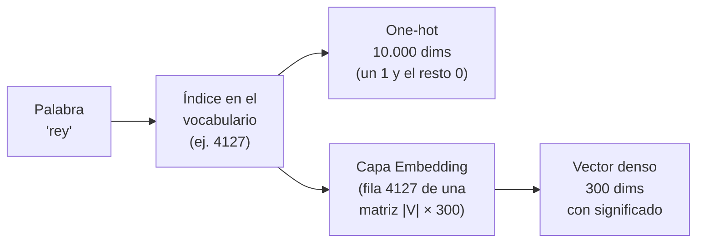

# 14 · Embeddings de palabras (Word2Vec)

> 🧩 **Guía de estudio para llegar a la clase con el tema masticado.**
> Fundamentada en las slides *Embeddings* (Lic. Mateo Suster, Ciencia de Datos FIUBA), en la parte de embeddings de *Redes recurrentes* (Ing. Juan M. Rodríguez) y en las notebooks de la práctica *13 - Embeddings*: entrenamiento de Word2Vec con *El Quijote* y embeddings preentrenados en español.
> Clase práctica del **jueves 5/11**.

---

## 🎯 En una frase

Un **embedding** representa cada palabra con un **vector corto y denso** (por ejemplo, de 300 números) aprendido de los **contextos** en que aparece. Así, las palabras que se usan parecido quedan **cerca** en el espacio, y hasta se puede hacer **álgebra**: rey − hombre + mujer ≈ reina.

---

## 🧭 ¿Por qué importa / dónde encaja?

- **Resuelve los límites de la bolsa de palabras y el one-hot** de la [guía 11](11%20-%20Procesamiento%20de%20lenguaje%20natural.md): vectores gigantes, casi todo ceros y sin noción de parecido.
- **Es la primera capa de toda red que procesa texto:**
  - las **redes recurrentes** ([guía 15](15%20-%20Redes%20recurrentes%20%28RNN%2C%20LSTM%2C%20GRU%29.md));
  - los **Transformers** ([guía 16](16%20-%20IA%20generativa%20-%20GAN%2C%20Deep%20Fakes%20y%20Transformers.md)), que arrancan convirtiendo tokens en embeddings.
- **Conecta con la reducción de dimensionalidad** ([guía 07](07%20-%20Reducci%C3%B3n%20de%20la%20dimensionalidad.md)): se pasa de 10.000 dimensiones (one-hot) a 300. Para **verlos** se usa PCA o t-SNE hasta 3D.

---

## 💡 La idea con una analogía

**El ejemplo de la clase: el "embedding de personalidad".**
- **Un rasgo:** en un test de personalidad, Jay saca 38/100 en introversión/extraversión. Eso ya es un número que lo describe.
- **Más rasgos:** con varios rasgos, Jay es un **vector**.
- **Para qué sirve:** si hay que **reemplazarlo** por alguien parecido, se busca el vector más **cercano**, midiendo el ángulo con el **coseno**.

Un embedding de palabras hace lo mismo con las palabras, con una diferencia clave: **nadie sabe qué significa cada dimensión**. La red eligió la codificación que le resultó más eficiente para predecir contextos.

---

## 🗺️ Del one-hot al embedding

---

## 📊 Conceptos clave

### Por qué el one-hot es una mala elección 🔴

- **Qué es el one-hot:** con un vocabulario de N palabras, cada una es un vector de largo N con un **1 en su posición** y ceros en el resto.

**Sus dos problemas:**
1. **Ineficiencia:** el largo depende del vocabulario (cientos de miles de palabras). Ocupa muchísimo y es casi todo ceros.
2. **Ortogonalidad:** **cualquier par de vectores one-hot es ortogonal**, así que todas las palabras están **a la misma distancia**:
   - "rey" está tan lejos de "reina" como de "burlete";
   - "gato", "gatos" y "gatita" no tienen nada en común;
   - no hay noción de **similitud**.

> 🔑 **Embedding = reducción de dimensionalidad con significado.** Con 10.000 palabras, en vez de vectores de dimensión 10.000 se usan vectores densos de dimensión **300**.

### Qué capturan los embeddings

- **Similitud:** palabras con usos parecidos quedan cerca (se mide con el **coseno**).
- **Relaciones semánticas:** "Estocolmo"→"Suecia" tiene la misma relación que "El Cairo"→"Egipto".
- **Relaciones sintácticas:** "tenía"→"tengo" es como "era"→"es".
- **Álgebra de embeddings:**
  - **rey − hombre + mujer ≈ reina.** No da exactamente "reina", pero "reina" es la palabra más cercana entre 400.000. El embedding codifica algo del **género**.
  - **Madrid − España + Francia ≈ París.** La "capital de" también queda codificada.
- **Visualizarlos:** los colores del vector GloVe de "rey" (50 dimensiones) muestran columnas que comparten las palabras de **personas** (y que "agua" no tiene), y columnas que comparten **rey** y **reina** (¿realeza?). Pero son **conjeturas**: no sabemos qué codifica cada dimensión.

### Semántica distribucional: de dónde sale el significado 🔴

- **Hipótesis distribucional:** «elementos lingüísticos con **distribuciones similares** tienen **significados similares**». Las palabras que aparecen en los mismos contextos significan cosas parecidas: "**dime con quién andas y te diré qué significas**".
- **La gran ventaja:** se entrena con **texto corriente**, que hay en abundancia (libros, Wikipedia, artículos). Solo hace falta saber qué palabras aparecen **juntas**. **No hacen falta etiquetas** hechas a mano.

### Word2Vec: dos modelos

- **Qué es:** una herramienta que trae dos modelos, **skip-gram** y **CBOW**.
- **Son auto-supervisados:** la "etiqueta" sale del mismo texto (cuál es la palabra vecina).

| | **Skip-gram** | **CBOW** (*continuous bag of words*) |
| --- | --- | --- |
| Qué predice | Las **palabras de contexto** a partir de la **palabra central** | La **palabra central** a partir de las **palabras de contexto** (promediadas) |
| Ventajas | Anda bien con **palabras poco frecuentes**. Mejor para **relaciones semánticas** | **Más rápido** de entrenar. Mejor para **palabras frecuentes** y relaciones **sintácticas** |
| Desventajas | Más **lento** | Peor con palabras raras y relaciones semánticas |

**Las cuentas de skip-gram** (para entender, no para memorizar):
- **Dos vectores por palabra:** cada palabra tiene **v** (cuando es **central**) y **u** (cuando es de **contexto**).
- **La probabilidad de una palabra de contexto:** P(contexto o | central c) = exp(uₒ · v_c) / Σᵢ exp(uᵢ · v_c). Es un **softmax** sobre todo el vocabulario.
- **La ventana:** se toman las palabras a no más de *m* posiciones (en la slide, m = 2) y se asume que son **independientes** dada la central.
- **El entrenamiento:** se maximiza la **verosimilitud** de todos los contextos del texto. En la práctica se **minimiza** su versión negativa: log, signo cambiado y promedio.
- **CBOW es igual pero al revés:** **promedia** los vectores de contexto y predice la central.

### Muestreo negativo (*negative sampling*) 🟠

- **El problema:** el softmax suma sobre **todo el vocabulario**. Con cientos de miles de palabras, cada gradiente es carísimo.
- **El truco:** cambiar la pregunta. En vez de "¿cuál es la palabra de contexto?" (softmax multiclase), se pregunta "**¿estas dos palabras son vecinas, sí o no?**", que es una **regresión logística** binaria con sigmoide. Mucho más rápido.
- **El riesgo:** si todos los ejemplos son vecinos (etiqueta 1), el modelo aprende a decir siempre 1. Tiene **100% de accuracy** sin aprender nada, y los embeddings salen basura.
- **La solución:** agregar **K muestras negativas** por cada par (palabras que **no** son vecinas, con etiqueta 0):
  - en la práctica, **K = 5**;
  - se eligen con probabilidad proporcional a la **frecuencia relativa elevada a 0,75**, como sugiere el paper de Word2Vec;
  - la pérdida es la **entropía cruzada binaria** (sigmoidea).

### Cómo se entrena (paso a paso)

1. **Crear dos matrices** de tamaño |V| × d:
   - la de **embedding**, con los vectores v de cada palabra como central;
   - la de **contexto**, con los vectores u.
2. **Buscar los vectores:** pasar los índices de la palabra central, sus contextos y sus negativas por esas "capas" para obtener sus vectores.
3. **Comparar:** hacer el **producto punto** entre la central y cada contexto o negativa. Es proporcional al coseno: mide parecido.
4. **Calcular la pérdida y ajustar:** pérdida sigmoidea y retropropagación.
5. **Quedarse con la matriz de embedding:** al final, Word2Vec usa **esa** y **descarta la de contexto**.

> 🔑 **La particularidad:** los embeddings que queremos obtener **son los mismos parámetros** que se entrenan. No se usa la "salida" de la red, sino sus **pesos**.

---

## 🧪 La práctica (notebooks del 5/11)

### I — Entrenar Word2Vec con *El Quijote* (skip-gram + muestreo negativo, PyTorch)

- **Corpus:** *El ingenioso hidalgo don Quijote de la Mancha*. Es **demasiado chico**, así que los resultados son pobres: en serio haría falta algo como Wikipedia entera.
- **Vocabulario con frecuencia mínima:** baja mucho su tamaño y ahorra parámetros.
- **Subsampling:** las palabras **hiperfrecuentes** ("que", "de", "y") aparecen con todo y aportan poca señal. Se **descartan** al azar con una probabilidad que crece con su frecuencia:
  - "que" se conserva menos de 1 de cada 20 veces;
  - "mesa" se conserva siempre.

  Las oraciones quedan más cortas y el entrenamiento, más rápido.
- **Palabras centrales y de contexto:** para cada palabra se sortea una ventana entre 1 y `max_window_size` (5).
- **Negativas:** K = 5 por par, con frecuencia^0,75.
- **Minilotes:** contextos y negativas concatenados, con **relleno (padding)** y una **máscara** para no contar el relleno en la pérdida.
- **Modelo:** dos capas `nn.Embedding` (dimensión 100) y un producto punto **por lotes**.
- **Aplicación:** buscar palabras **similares por coseno**.

**Qué es la capa `Embedding`:**
- es una matriz de |V| filas × d columnas (`input_dim` × `output_dim`);
- el índice *i* devuelve la **fila i**;
- un lote de índices de forma (2, 3) con d = 4 devuelve (2, 3, 4).

### II — Embeddings preentrenados (*Spanish Billion Words*)

- **Para qué:** muchas veces **no hace falta entrenar**: alguien ya lo hizo con un corpus enorme.
- **Qué se descarga:** **1.000.653 embeddings de dimensión 300**, entrenados con **skip-gram + muestreo negativo**:
  - frecuencia mínima 5;
  - 20 palabras negativas;
  - las 273 palabras más comunes submuestreadas.
- **Similitud:** se usa **K-NN por coseno**.
- **Analogías** (a : b :: c : d): la respuesta es la palabra más cercana a **vec(b) − vec(a) + vec(c)**.
  - "hombre" : "mujer" :: "hijo" : **"hija"**;
  - también país → gentilicio.
- **Usarlos en un modelo propio:**
  1. Armar una matriz (vocabulario propio × 300).
  2. A cada palabra del vocabulario le corresponde su vector preentrenado, **o uno aleatorio** si no está.
  3. Cargarla como pesos de la primera capa `Embedding`, seguida de una capa **GRU**.

---

## ⚠️ Ojo con las slides

| Dónde | Qué dice | Lo correcto |
| --- | --- | --- |
| *Embeddings*, tabla "Comparación entre métodos" | Objetivo de skip-gram: "predecir la palabra objetivo dada una palabra central" | Skip-gram predice las **palabras de contexto** dada la **central**. CBOW es el que predice la central |
| *Embeddings*, muestreo negativo | Lo describe como "un problema de **regresión** que devuelva la probabilidad de que dos palabras sean vecinas" | Es **regresión logística**: un **clasificador binario** (vecinas sí/no) que devuelve una probabilidad. No es una regresión de valores continuos |

---

## ❓ Preguntas para autoevaluarte

1. ¿Cuáles son los **dos problemas** del one-hot encoding?
2. ¿Qué es un **embedding** y qué ventaja tiene sobre el one-hot?
3. Enunciá la **hipótesis distribucional**. ¿Por qué permite entrenar sin etiquetas?
4. Diferenciá **skip-gram** de **CBOW**: qué predice cada uno y cuándo conviene cada uno.
5. ¿Por qué Word2Vec es **auto-supervisado**?
6. ¿Qué problema resuelve el **muestreo negativo**? ¿Por qué hacen falta las muestras negativas?
7. ¿Para qué sirve el **subsampling** de palabras frecuentes?
8. Al terminar de entrenar, ¿de dónde salen los embeddings? ¿Qué se hace con la matriz de contexto?
9. ¿Cómo resolverías la analogía "Madrid : España :: París : ?" con vectores?
10. ¿Qué limitación tienen los embeddings de Word2Vec frente al **contexto** ("banco" de plaza / de plata)? Ver la [guía 16](16%20-%20IA%20generativa%20-%20GAN%2C%20Deep%20Fakes%20y%20Transformers.md).

---

## 📌 Qué prestar atención en la clase

- La **intuición** (personalidad → vector → coseno) y las **analogías**.
- **Skip-gram vs. CBOW** y el **muestreo negativo**: son las preguntas más probables.
- En la práctica: **subsampling**, la capa **Embedding** y cómo se cargan vectores **preentrenados** en una red.

---

⚙️ Guía fundamentada en las slides *Embeddings* (Lic. Mateo Suster, Ciencia de Datos FIUBA; basadas en el curso de NLP del Instituto Humai y en Jurafsky & Martin), en la parte de embeddings de *Redes recurrentes* (Ing. Juan M. Rodríguez) y en las notebooks *Práctica de NLP - I - Entrenamiento Word2Vec* y *II - Embeddings Pre-entrenados*.
