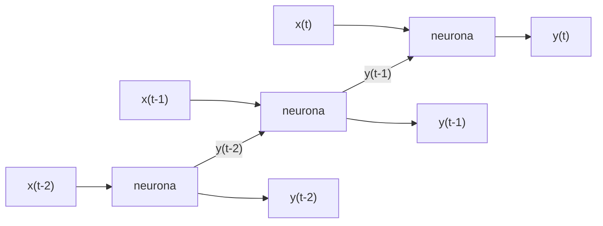

# 15 · Redes recurrentes (RNN, LSTM y GRU)

> 🧩 **Guía de estudio para llegar a la clase con el tema masticado.**
> Fundamentada en las slides *Redes recurrentes — Procesamiento de secuencias* (Dr. Ing. Juan M. Rodríguez, unidad *11 - Deep Nets*), con el ejemplo **Robo-Shakespeare**, y en la parte de recurrentes de *Introducción a las redes de aprendizaje profundo*.
> Teórica y práctica de la semana del **10/11** ("Redes neuronales recurrentes y generativas").

---

## 🎯 En una frase

Una **red recurrente** procesa **secuencias**: en cada paso recibe el dato nuevo **y su propia salida del paso anterior**, así que tiene una especie de **memoria**. Como esa memoria es corta, se inventaron celdas con "puertas" (**LSTM** y **GRU**) que deciden qué **olvidar** y qué **recordar**.

---

## 🧭 ¿Por qué importa / dónde encaja?

- **Las redes de la [guía 10](10%20-%20Redes%20neuronales%20%28perceptr%C3%B3n%2C%20MLP%2C%20backpropagation%2C%20SOM%29.md) y las CNN** ([guía 12](12%20-%20Introducci%C3%B3n%20al%20aprendizaje%20profundo.md)) reciben una entrada de **tamaño fijo** y no recuerdan nada entre ejemplos.
- **Mucho de lo que importa es una secuencia:** texto, voz, video y **series de tiempo** (precios, temperaturas, demanda).
- **Las recurrentes fueron el estándar para texto** hasta que llegaron los **Transformers** ([guía 16](16%20-%20IA%20generativa%20-%20GAN%2C%20Deep%20Fakes%20y%20Transformers.md)). Usan **embeddings** ([guía 14](14%20-%20Embeddings%20%28Word2Vec%29.md)) como entrada.

---

## 💡 La idea con una analogía

Una neurona recurrente es como **leer una novela**:
- **cada palabra se entiende con lo que ya leíste** (la salida del paso anterior);
- **el problema:** después de 300 páginas te olvidás de lo que pasaba al principio. Eso es la **memoria a corto plazo** de una RNN simple;
- **la solución LSTM:** es como tomar **notas al margen**. Un cuaderno aparte (el estado a largo plazo) donde decidís qué **borrar**, qué **anotar** y qué **releer** en cada capítulo.

---

## 🗺️ La neurona recurrente desplegada en el tiempo

> Es **la misma neurona** (los mismos pesos), dibujada una vez por paso temporal.

---

## 📊 Conceptos clave

### Cómo funciona una neurona recurrente 🔴

- **Tiene dos entradas:** la habitual **x(t)** y **su salida del paso anterior y(t−1)**.
- **Tiene dos conjuntos de pesos:**
  - **wₓ**, para la entrada;
  - **w_y**, para la salida anterior.

  En una **capa** son matrices: **Wₓ** y **W_y**.
- **La ecuación de una capa:** **y(t) = φ( Wₓᵀ · x(t) + W_yᵀ · y(t−1) + b )**, donde φ es la activación y b, el bias. Las dos matrices se pueden juntar en una sola **W**.
- **Celda de memoria:** la parte de la red que **mantiene estado** a lo largo de los pasos. Una sola neurona recurrente ya es una celda.
- **Las formas de los datos:** en una neurona, entrada y salida son **vectores**, X = (x(t−3), …, x(t)). En una capa son **matrices**.

### Los tres esquemas de entrada y salida 🔴

| Entrada → salida | Ejemplo |
| --- | --- |
| **Secuencia → secuencia** | Series de tiempo: los precios de los últimos N días → los mismos precios **corridos un día** hacia el futuro. También clasificar video cuadro a cuadro |
| **Secuencia → un valor** | **Análisis de sentimientos**: entran las palabras de una crítica, una por paso, y sale un único valor entre −1 (odio) y +1 (amor) |
| **Un valor → secuencia** | **Ponerle título a una imagen**: entra la imagen (o la salida de una CNN) una y otra vez y va generando las palabras |

> Con una **demora** entre entrada y salida, la red también puede **pronosticar** la demanda de una cadena de suministros.

### Entrenamiento: BPTT 🟠

**Backpropagation through time:**
1. **Hacia adelante:** se ejecuta la red de forma normal.
2. **Desplegar:** se despliega en el tiempo.
3. **Pérdida:** se calcula solo sobre los **últimos T pasos** (se ignoran algunas salidas).
4. **Hacia atrás:** se aplica backpropagation de siempre sobre la red desplegada.

### Series de tiempo

- **Qué son:** valores medidos a lo largo del tiempo.
  - **Univariable:** temperatura [22, 23, 25, 17, 28], un valor por día, 5 pasos.
  - **Multivariable:** deudas, ingresos y egresos por mes.
- **La tarea típica:** predecir el **próximo** valor. ¿Qué temperatura hará el sábado?
- **La métrica:** como el valor es continuo, el **error cuadrático medio (MSE)**.
- **La línea base:** la **predicción naïve**, que dice que el próximo valor es igual al **último** observado. Si la red no le gana, no sirve.

### Implementación en Keras

- **La red más simple:** `SimpleRNN(1, input_shape=[None, 1])`, una capa con una neurona.
  - **`None`:** una RNN procesa **cualquier cantidad** de pasos.
  - **Activación por defecto:** **tangente hiperbólica**.
- **`return_sequences=True`:** por defecto, una capa recurrente devuelve **solo la salida final**. Para pasar todos los pasos a la capa siguiente, hay que activarlo en **todas las capas menos la última**. Así se arma una **RNN profunda** (capas apiladas).
- **El truco de la última capa:** si solo se quiere **un valor final**, conviene que la última capa sea una **`Dense(1)`** y no recurrente. Converge más rápido y anda igual de bien.
- **Predecir N pasos hacia adelante,** dos enfoques:
  1. Predecir un paso, **meterlo como entrada** y repetir N veces.
  2. Entrenar un modelo que devuelva **los N pasos de una vez**, con los *targets* de N pasos en el entrenamiento.

### Problemas de las RNN y sus soluciones 🔴

**Los problemas:**
- **Desvanecimiento del gradiente** (como toda red profunda), y es **peor**: una capa con 100 pasos es como una red de 100 capas.
- **Gradientes inestables:** cuesta que converja.
- **Memoria a corto plazo:** es **propio** de las RNN. No recuerdan secuencias largas.

**Las soluciones:** celdas **LSTM**, celdas **GRU**, **GRU + convolucionales 1D**, *gradient clipping* y mejores optimizadores.

### LSTM (*Long Short-Term Memory*, Hochreiter y Schmidhuber, 1997)

- **Vista como caja negra:** es una celda común que **anda mejor**: converge más rápido y detecta dependencias **mucho más largas**.
- **Por dentro tiene dos estados:**
  - **h(t)**, el estado a **corto** plazo, que también es la salida;
  - **c(t)**, el estado a **largo** plazo.

| Parte | Qué hace |
| --- | --- |
| **Capa principal g(t)** | Una capa densa que combina la entrada actual con el estado a corto plazo. Es "la neurona recurrente" propiamente dicha |
| **Puerta de olvido f(t)** | Decide qué partes del estado a largo plazo **se borran** (multiplicación) |
| **Puerta de entrada i(t)** | Decide qué partes de g(t) **se suman** al estado a largo plazo |
| **Puerta de salida o(t)** | Decide qué parte del estado a largo plazo **se lee** en este paso: se pasa por tanh y sale como h(t) e y(t) |

> 🔑 **El camino del estado a largo plazo:** primero **se olvida** algo (×) y después **se agregan recuerdos** nuevos (+). Como no pasa por una activación que lo aplaste en cada paso, el gradiente **no se desvanece** tan rápido.

### GRU (*Gated Recurrent Unit*, Cho y otros, 2014)

- **Es una LSTM simplificada** que anda igual de bien.
- **Un solo estado:** los dos vectores se fusionan en **h**.
- **Un solo controlador z** maneja el olvido **y** la entrada a la vez:
  - z = 1 → abre la puerta de olvido y cierra la de entrada;
  - z = 0 → al revés.

### GRU + convolucionales 1D

- **Cómo funciona:** una **Conv1D** recorre la secuencia con kernels 1D y extrae características. Con 10 kernels salen 10 secuencias de características.
- **Para qué:** esas secuencias entran a la GRU, que así puede manejar **secuencias más largas**.

---

## ✍️ Robo-Shakespeare: generar texto carácter por carácter

**El objetivo:** entrenar una RNN con **todos los textos de Shakespeare** para que, dado un texto, **prediga el próximo carácter**.

**Los pasos:**
1. **Texto plano:** todo Shakespeare en un solo string.
2. **Tokenizar a nivel carácter:**
   - un tokenizador "entrenado" con todo el texto le da un **ID** a cada carácter distinto;
   - encuentra **39**: "First" → 20, 6, 9, 8, 3;
   - con −1 los IDs quedan de 0 a 38.
3. **Partir:** **90%** para entrenar, **5%** para validar y **5%** para testear.
4. **Armar ventanas:** el problema es que **no hay N observaciones, sino un único array** de caracteres.
   - Se cortan **ventanas** de tamaño fijo con desplazamiento **1** (se solapan), usando `window()`.
   - Después se "aplanan" con `flat_map`.
5. **Mezclar las ventanas** (rompe la secuencialidad y ayuda a encontrar mejores soluciones) y armar lotes:
   - **entrada** = de la primera al **anteúltimo** carácter;
   - **target** = de la segunda al **último**. O sea, el target es la entrada **corrida un carácter**.
6. **Codificar** cada ID en **one-hot** de 39 posiciones.
7. **Modelo:** capas **GRU de 128** neuronas y una salida **densa distribuida en el tiempo** de **39 neuronas con softmax**, una por carácter posible.
8. **Probar:** con "How are yo", la red debería predecir **"u"**.
9. **Generar texto:**
   - Si siempre se toma el carácter **más probable**, el texto sale repetitivo.
   - Mejor **muestrear** de la distribución del softmax, reescalada con la **temperatura**:
     - cerca de **0** favorece los caracteres más probables (texto conservador);
     - alta da texto más original pero menos coherente.

> 🔑 La misma idea de "predecir el **siguiente** elemento de la secuencia" es la base de los **LLM** ([guía 16](16%20-%20IA%20generativa%20-%20GAN%2C%20Deep%20Fakes%20y%20Transformers.md)), que cambian la RNN por un **Transformer** y los caracteres por **tokens**.

---

## ⚠️ Ojo con las slides

| Dónde | Qué dice | Lo correcto |
| --- | --- | --- |
| Slide 13 (métricas) | "Una de las formas más simples de evaluar qué tan bien predice una RNR es hacer que prediga el último valor de cada serie… se llama predicción naïve" | La **predicción naïve** no es una forma de usar la RNN: es una **línea base** sin modelo, que predice que el próximo valor es **igual al último observado**. Se compara el **MSE de la red** contra el MSE de esa línea base |

---

## ❓ Preguntas para autoevaluarte

1. ¿Qué dos entradas tiene una neurona recurrente? Escribí la ecuación de una capa.
2. ¿Qué es una **celda de memoria**?
3. Dá un ejemplo de cada esquema: **secuencia→secuencia**, **secuencia→valor** y **valor→secuencia**.
4. ¿Qué es **BPTT**?
5. ¿Qué es la **predicción naïve** y para qué sirve?
6. ¿Para qué sirve `return_sequences=True`? ¿En qué capas va?
7. ¿Por qué conviene una capa **Dense** al final si se predice un solo valor?
8. Nombrá los **tres problemas** de las RNN. ¿Cuál es propio de ellas?
9. Explicá las tres **puertas** de una LSTM. ¿Qué gana frente a una RNN simple?
10. ¿En qué se simplifica una **GRU**?
11. En Robo-Shakespeare, ¿cómo se arman entradas y targets a partir de **un solo texto**? ¿Para qué sirve la **temperatura**?

---

## 📌 Qué prestar atención en la clase

- La **ecuación** y el **despliegue en el tiempo**.
- Los **tres esquemas** de entrada y salida, con sus ejemplos.
- **LSTM vs. GRU**, qué problema resuelven.
- Si hay notebook de Robo-Shakespeare: **ventanas**, *targets* corridos y **temperatura**.

---

⚙️ Guía fundamentada en las slides *Redes recurrentes — Procesamiento de secuencias* y la parte de redes recurrentes de *Introducción a las redes de aprendizaje profundo* (Dr. Ing. Juan M. Rodríguez, unidad *11 - Deep Nets*).
