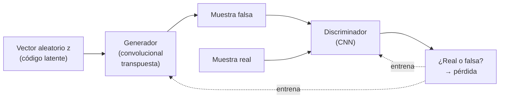
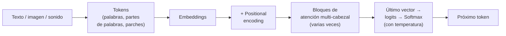

# 16 · IA generativa: GAN, deep fakes y Transformers

> 🧩 **Guía de estudio para llegar a la clase con el tema masticado.**
> Fundamentada en las slides de la unidad *11 - Deep Nets* (Dr. Ing. Juan M. Rodríguez): *Generative AI & Transformers*, *Redes GAN* y *Deep Fake Nets*.
> En el cronograma:
> - **10/11:** recurrentes y generativas;
> - **17/11:** modelos preentrenados (YOLO, GAN, VQGAN);
> - **24/11:** LLMs y RAG.

---

## 🎯 En una frase

La **IA generativa** no clasifica: **crea datos nuevos** parecidos a los de entrenamiento.
- Las **GAN** lo hacen enfrentando a dos redes: una que **falsifica** y otra que **detecta falsificaciones**.
- Los **Transformers** (la "T" de GPT) generan texto **prediciendo el próximo token**, gracias a la **atención**: cada palabra actualiza su significado mirando a las demás.

---

## 🧭 ¿Por qué importa / dónde encaja?

- **De dónde viene:**
  - de las **CNN** ([guía 12](12%20-%20Introducci%C3%B3n%20al%20aprendizaje%20profundo.md)), que usan generador y discriminador;
  - de los **autoencoders**, que son la base de los deep fakes;
  - de los **embeddings** ([guía 14](14%20-%20Embeddings%20%28Word2Vec%29.md)), la entrada del Transformer;
  - de **predecir el siguiente elemento**, que ya hacía Robo-Shakespeare ([guía 15](15%20-%20Redes%20recurrentes%20%28RNN%2C%20LSTM%2C%20GRU%29.md)).
- **Dónde se ubica la IA generativa:** **IA ⊃ machine learning ⊃ deep learning ⊃ IA generativa**. Los **LLM** (grandes modelos de lenguaje) son parte de la IA generativa.

| Modelo **discriminativo** | Modelo **generativo** |
| --- | --- |
| **Clasifica o predice** | **Genera datos nuevos** parecidos a los de entrenamiento |
| Se entrena con datos **etiquetados** | Aprende la **distribución** de los datos |
| Aprende la relación entre características y etiquetas | Por ejemplo, **predice la próxima palabra** de una secuencia |

---

## 💡 La idea con una analogía

- **Una GAN es un falsificador contra un perito:**
  - el **generador** pinta billetes falsos;
  - el **discriminador** trata de distinguirlos de los verdaderos;
  - cada vez que el perito lo descubre, el falsificador mejora, y cada vez que lo engaña, el perito aprende;
  - al final los billetes falsos son indistinguibles: así salen las caras de *thispersondoesnotexist.com*.
- **La atención de un Transformer es una charla entre palabras.** En "una criatura **peluda** y **azul**", la palabra "criatura" pregunta: *"che, ¿hay algún adjetivo por acá que me esté modificando?"*. "Peluda" y "azul" contestan *"¡yo!"*, y "criatura" se actualiza a "criatura-peluda-azul".

---

## 1️⃣ GAN: Redes Generativas Adversarias (Goodfellow y otros, 2014)

### Qué son

- **Son redes no supervisadas.**
- **No** arman clusters, **no** clasifican y **no** resuelven regresiones: **generan datos nuevos**.
- **Usos:** caras que no existen, imágenes a partir de bocetos, mejora de resolución, cambiar el estilo de una foto.

### Cómo funcionan 🔴

1. **El generador fabrica:** recibe un **vector aleatorio** (el "código latente") y lo transforma en una imagen, con capas **convolucionales transpuestas**, que hacen lo inverso de una convolución: **agrandan** en vez de achicar. Por ejemplo, un generador de dígitos de 28×28 píxeles.
2. **El discriminador decide:** es una **CNN** que recibe, alternadamente, muestras **reales** y **falsas**, y dice si cada una es real o falsa.
3. **Los dos aprenden de la misma pérdida:**
   - el discriminador, a **no dejarse engañar**;
   - el generador, a **engañarlo**.

### ProGAN y sus límites

- **Qué hace ProGAN:** **crece progresivamente**. Empieza generando imágenes de 4×4 y va sumando capas hasta **1024×1024**. Así genera imágenes de **alta calidad**.
- **El límite:** casi **no se pueden controlar** características puntuales de la imagen. Las características están **enredadas**: tocar un poquito la entrada cambia varias cosas a la vez, como un **gen** que afecta varios rasgos.
- **StyleGAN** (Karras y otros, 2019) atacó ese problema con un generador basado en **estilos**. Es el de las caras humanas de la bibliografía.

---

## 2️⃣ Deep fakes con autoencoders

Un **autoencoder** aprende a reconstruir su entrada pasando por un **código** chico en el medio: **codificador → código → decodificador** ([guía 12](12%20-%20Introducci%C3%B3n%20al%20aprendizaje%20profundo.md)).

1. **Entrenar un autoencoder con la cara 1** (miles de fotos de la persona A).
2. **Entrenar un autoencoder con la cara 2** (la persona B).
3. **El "trucazo":** pasar la cara de A por el **codificador** y reconstruirla con el **decodificador de B**.
   - El código guarda **la pose y el gesto**.
   - El decodificador de B los "dibuja" con **la cara de B**.

**Antes de todo eso, encontrar la cara:** una **CNN** detecta la cara en cada cuadro del video, y ese recuadro es lo que pasa por el autoencoder.

> 🔑 Para que el código de A "sirva" al decodificador de B, en la práctica los dos autoencoders **comparten el codificador**. Así los dos aprenden un mismo espacio de poses y gestos, y cada uno tiene **su propio decodificador**.

---

## 3️⃣ Transformers

### De dónde salen

- **GPT = *Generative Pre-trained Transformer*:**
  - **genera** datos;
  - ya viene **preentrenado** (se puede refinar con *fine tuning*);
  - y es un **Transformer**.
- **El primer Transformer** es de **2017**: *Attention Is All You Need*, de ocho investigadores de Google. Se basa en el mecanismo de **atención** de Bahdanau (2014) y se creó para **traducir**.
- **Hoy es la arquitectura de los LLM**, y también de voz a texto, texto a voz y texto a imagen.

### La idea básica: predecir el próximo token 🔴

- **Qué devuelve el Transformer:** dada "En la tierra de Nunca Jamás, había una vez un…", devuelve una **distribución de probabilidades** para la próxima palabra: niño 22%, pirata 13%, hada 5%…
- **Cómo genera texto:** se elige una, **se agrega** al texto y se repite.
- **Cómo funciona un chatbot:** es lo mismo, con un **texto inicial del sistema** que el usuario no ve ("A continuación hay una conversación entre un usuario y un asistente de IA amigable…"), seguido del **prompt** del usuario.

### Los pasos dentro de un Transformer

**1. Tokens y embeddings.**
- El texto se parte en **tokens**: palabras, partes de palabras o combinaciones de caracteres. Una **imagen** se parte en parches, y un **sonido**, en fragmentos.
- Cada token pasa a un **embedding**.

**Los embeddings solos no alcanzan:**
- **no saben el orden:** "el gato comió al ratón" = "el ratón comió al gato";
- **no saben el contexto:** "robó un **banco**" vs. "se sentó en un **banco**";
- **cada palabra de contexto mueve el embedding:** "torre" está cerca de "estructuras altas", "torre Eiffel" se acerca a "París" y "torre Eiffel miniatura" se acerca a "llaveros".

**2. Positional encoding: codificar la posición.**
- **Poner 1, 2, 3… no sirve:** las redes manejan mal los números discretos y grandes, que arruinan el entrenamiento.
- **Hace falta una función continua, suave y acotada:** el **seno**.
- **El problema del seno:** es periódico, así que posiciones lejanas pueden dar valores parecidos.
- **La solución:** sumar **coseno** y varias **frecuencias** distintas (sin(p), cos(p), sin(p/2), cos(p/2), …) para que las posiciones no se repitan.
- **En el paper original,** el vector de posición tiene la **misma dimensión que el embedding (512)** y **se le suma**. Las distancias y el álgebra de embeddings se mantienen.

**3. Atención (*self-attention*) 🔴**

Cada embedding **E** genera tres vectores, multiplicándolo por tres matrices que se **aprenden en el entrenamiento**:

| Vector | Matriz | Qué "representa" (en el ejemplo de la criatura peluda) |
| --- | --- | --- |
| **Query (Q)** | W_Q | La **pregunta**: "¿hay algún adjetivo cerca que me modifique?". Tiene una dimensión **menor** que el embedding (por ejemplo, 128) |
| **Key (K)** | W_K | La **posible respuesta**: "soy un adjetivo en la posición 2". Misma dimensión que Q |
| **Value (V)** | W_V | **Cuánto y cómo** modifica: el vector que se le suma al otro embedding |

1. **Producto punto Q·K de todos contra todos:** cuanto **más alineados**, más "**atiende**" esa clave a esa consulta.
2. **Dividir por √(dimensión de Q)** (√128 ≈ 11,3), por **estabilidad numérica**.
3. **Enmascarar:** al **entrenar**, cada palabra se predice mirando **solo las anteriores**. Las posiciones futuras se ponen en **−∞** para que el softmax las deje en **0**. Esto se llama ***masking***.
4. **Softmax** por columna: cada columna suma 1. El resultado es el **patrón de atención**.
5. **Actualizar:** con esos pesos se combinan los vectores **V** y la suma **se agrega al embedding original**. "Criatura" pasa a codificar "criatura-peluda-azul".

**Detalles que suman:**
- **Tamaño del contexto:** cada columna del patrón tiene tantas posiciones como **tokens** pueda procesar el modelo (su ventana de contexto). Pasada la ventana, el modelo "**se olvida**" del principio.
- **Para contextos largos** hay variantes que no miran todos contra todos:
  - **Longformer:** atención local y algunas posiciones globales;
  - **BigBird:** atención local, aleatoria y global;
  - **Performer:** una aproximación con *kernels*;
  - **Reformer:** *hashing* para que cada token mire solo a los relevantes.
- **W_V en realidad son dos matrices** más chicas: una "baja" a la dimensión de la consulta y otra "sube" de vuelta. Así hay **menos parámetros**, y es clave para tener muchas cabezas.

**4. Multi-head attention.**
- **Para qué:** una sola W_Q detectaría un solo tipo de relación (por ejemplo, adjetivo → sustantivo). Hacen falta **muchas** para todas las formas en que el contexto modifica una palabra. "Homero", por ejemplo, puede ser el poeta griego o el padre de Bart.
- **Qué es una cabeza:** cada **cabezal de atención** (*attention head*) es un juego de W_Q, W_K y W_V. **GPT-3 tiene 96.**
- **Por qué es eficiente:** los cabezales se calculan **en paralelo**, y eso es parte de su éxito.
- **Un detalle de nombres:** las matrices que "suben" de todas las cabezas se suelen juntar en una **matriz de salida** (*output matrix*).

**Self-attention vs. cross-attention:**

| | **Self-attention** | **Cross-attention** |
| --- | --- | --- |
| Quién genera Q y K | El **mismo** texto | Textos **distintos** |
| Uso | Entender el contexto de una oración | **Traducción**: Q = "¿qué palabra traduce *profesor*?", K = "*teacher*" |
| Máscara | Sí, al generar | **No** |

**5. La predicción.**
- **De dónde sale:** el próximo token depende **solo del último vector**. Después de pasar por muchos bloques de atención, ese vector **ya tiene todo el contexto**. En una novela de misterio que termina en "Por lo tanto el asesino era…", el embedding de "era" debería codificar toda la trama.
- **Cómo se elige:** los valores finales (**logits**) se pasan por **softmax** para obtener probabilidades.
- **Temperatura:**
  - **alta** da más chances a los tokens menos probables: más original, menos coherente;
  - **baja** elige casi siempre el más probable.

---

## ⚠️ Ojo con las slides

| Dónde | Qué dice | Lo correcto |
| --- | --- | --- |
| *Generative AI & Transformers*, positional encoding | "Una palabra debería usar **1024 dimensiones**: 512 para el embedding y 512 para la posición" (concatenadas) | En *Attention Is All You Need*, el vector de posición tiene la **misma dimensión** que el embedding (d_model = 512) y **se suma**, no se concatena. Por eso no agrega dimensiones a las matrices |
| *Generative AI & Transformers*, slide 26 | "El primer gran modelo… fue **GPT 3.0 en 2022**, a través de ChatGPT" | GPT-3 es de **2020**. ChatGPT salió en **noviembre de 2022** con **GPT-3.5** |
| *Generative AI & Transformers*, slide 73 | GPT-3 davinci: ventana de ≈ 4096 tokens | El GPT-3 original (2020) tenía **2048**. Las 4096 son de versiones posteriores (text-davinci-002/003). La idea de la slide (el modelo "olvida" pasada la ventana) es correcta |
| *Generative AI & Transformers*, GAN | "ProGAN es una mejora de GAN **de 2019**", y cita a Gao, Pei y Huang (2019) | La ProGAN de imágenes es ***Progressive Growing of GANs*** (Karras y otros, presentada en ICLR **2018**). El paper de Gao y otros es **otra** ProGAN, de *embeddings* de grafos |

---

## ❓ Preguntas para autoevaluarte

1. ¿Qué diferencia a un modelo **generativo** de uno **discriminativo**?
2. Explicá cómo se entrena una **GAN**. ¿Qué hace cada red y qué es el código latente?
3. ¿Para qué sirve una capa **convolucional transpuesta**?
4. ¿Qué limitación tiene ProGAN? ¿Qué quiere decir que las características están "**enredadas**"?
5. Explicá los tres pasos para armar un **deep fake** con autoencoders.
6. ¿Qué significa **GPT**?
7. ¿Cómo genera texto un Transformer? ¿Cómo funciona un chatbot con eso?
8. ¿Qué dos cosas **no** saben los embeddings? ¿Cómo lo resuelve el Transformer?
9. ¿Por qué el **positional encoding** usa senos y cosenos de distintas frecuencias, y no 1, 2, 3…?
10. Explicá **Query, Key y Value**. ¿Para qué se divide por √d?
11. ¿Qué es el ***masking*** y por qué se pone −∞ en vez de 0?
12. ¿Para qué sirven **muchas cabezas** de atención?
13. Diferenciá **self-attention** de **cross-attention**.
14. ¿Qué efecto tiene la **temperatura**?

---

## 📌 Qué prestar atención en la clase

- **GAN:** el juego generador contra discriminador y el código latente.
- **Transformers:**
  - "predecir el próximo token";
  - **positional encoding**;
  - **Q/K/V con masking**;
  - **multi-head**;
  - **temperatura**.
- La clase de **LLMs y RAG** (24/11) arranca de acá.

---

⚙️ Guía fundamentada en las slides *Generative AI & Transformers*, *Redes GAN* y *Deep Fake Nets* (Dr. Ing. Juan M. Rodríguez, unidad *11 - Deep Nets*). La explicación de atención de la cátedra se basa en los videos de 3Blue1Brown.
