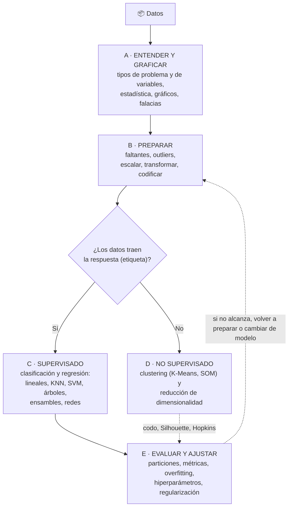

# 🧭 Mapa de temas del parcial — Ciencia de Datos

> **Para el recuperatorio del jueves 19/11.** Este archivo **no trae temas nuevos**: ordena los que ya están en las guías. Sirve para saber **en qué cajón va cada cosa**, **qué tipos hay de cada una** y **en qué se diferencian las que se parecen**.
>
> **Cómo usarlo:**
> 1. Mirá el [dibujo de la materia](#1-la-materia-en-un-dibujo) hasta poder hacerlo de memoria. Es el esqueleto: todo lo demás se cuelga de ahí.
> 2. Recorré los cinco bloques. En cada uno, primero el **árbol de subtemas** y después las tablas **"No confundir"**.
> 3. Si un subtema no te cierra, seguí el link: el [Resumen para el parcial](Resumen%20para%20el%20parcial.md) tiene la explicación y las cuentas, y el [Resumen simple](Resumen%20simple.md) la versión fácil.
> 4. La [sección 7](#7--palabras-que-significan-cosas-distintas) junta las palabras que se repiten con otro significado (**K**, **regresión**, **varianza**, **sesgo**…). Es donde más se confunde.

---

## 1. La materia en un dibujo

Todo lo que se vio hasta el parcial es **un paso de un proyecto de datos**. Los modelos se dividen según una sola pregunta: **¿los datos traen la respuesta (la etiqueta)?**



### Los cinco bloques en una tabla

| Bloque | Pregunta que responde | Qué temas entran | Guías | Resumen para el parcial | ¿Cuánto lo toman? |
| --- | --- | --- | --- | --- | --- |
| **A · Entender y graficar** | ¿Qué tengo? | Tipos de problema y de variables, estadística descriptiva, correlación, gráficos, falacias | [01](01%20-%20Introducci%C3%B3n%20a%20la%20materia.md) · [02](02%20-%20Visualizaci%C3%B3n%20de%20datos.md) · [03](03%20-%20Introducci%C3%B3n%20a%20la%20ciencia%20de%20datos.md) | [§1](Resumen%20para%20el%20parcial.md#1-fundamentos) · [§2](Resumen%20para%20el%20parcial.md#2-visualización-y-falacias) | Tipos de problema: 4 de 8 parciales |
| **B · Preparar** | ¿Están listos los datos? | Faltantes, outliers, escalado, transformaciones, codificación de categorías | [05](05%20-%20Limpieza%20y%20normalizaci%C3%B3n%20de%20datos.md) | [§4](Resumen%20para%20el%20parcial.md#4-ingeniería-de-características-feature-engineering) | Outliers: 4 de 8 · feature engineering: 3 de 8 |
| **C · Supervisado** | ¿De qué clase es? ¿Cuánto vale? | Regresión lineal y logística, KNN, SVM, árboles, ensambles, redes neuronales | [06](06%20-%20%C3%81rboles%20-%20ID3%2C%20C4.5%20y%20Random%20Forest.md) · [08](08%20-%20Clasificaci%C3%B3n%20y%20regresi%C3%B3n%20cl%C3%A1sicos%20%28K-NN%2C%20SVM%2C%20lineal%2C%20log%C3%ADstica%29.md) · [09](09%20-%20Ensamble%20de%20modelos%20%28AdaBoost%2C%20Gradient%20Boosting%2C%20XGBoost%29.md) · [10](10%20-%20Redes%20neuronales%20%28perceptr%C3%B3n%2C%20MLP%2C%20backpropagation%2C%20SOM%29.md) | [§5](Resumen%20para%20el%20parcial.md#5-regresión-lineal-descenso-por-gradiente-y-regresión-logística) · [§7](Resumen%20para%20el%20parcial.md#7-árboles-de-decisión) · [§8](Resumen%20para%20el%20parcial.md#8-ensambles) · [§9](Resumen%20para%20el%20parcial.md#9-knn-y-svm) · [§10](Resumen%20para%20el%20parcial.md#10-redes-neuronales) | **Redes: 6 de 8 · ensambles: 5 de 8** · árboles: 3 de 8 |
| **D · No supervisado** | ¿Qué estructura esconden los datos? | K-Means (con Hopkins, codo y Silhouette), SOM, PCA, MDS, ISOMAP, t-SNE | [07](07%20-%20Reducci%C3%B3n%20de%20la%20dimensionalidad.md) · [13](13%20-%20M%C3%A9todos%20de%20agrupamiento%20%28Clustering%29.md) · SOM en la [10](10%20-%20Redes%20neuronales%20%28perceptr%C3%B3n%2C%20MLP%2C%20backpropagation%2C%20SOM%29.md) | [§6](Resumen%20para%20el%20parcial.md#6-clustering-k-means) · [§11](Resumen%20para%20el%20parcial.md#11-reducción-de-la-dimensionalidad) | **Reducción: 4 de 8 (los tres últimos años)** |
| **E · Evaluar y ajustar** | ¿El modelo sirve? ¿Cómo lo mejoro? | Particiones, métricas, overfitting y underfitting, sesgo y varianza, búsqueda de hiperparámetros, regularización | [04](04%20-%20M%C3%A9tricas.md) | [§3](Resumen%20para%20el%20parcial.md#3-cómo-se-evalúa-un-modelo) · [§13](Resumen%20para%20el%20parcial.md#13-hiperparámetros-qué-pasa-si-los-subo) | **Métricas: 7 de 8** · overfitting: 4 de 8 |

> 📌 **Además:** las **preguntas sobre el TP1** aparecieron en 6 de 8 parciales. Cruzan los bloques B (qué preprocesamiento hicieron, qué outliers encontraron) y D (cuántos clusters eligieron y qué representan). Están en `TP1 (privado)/`, solo en local.

---

## 2. 🔎 Bloque A — Entender y graficar los datos

```
A. ENTENDER Y GRAFICAR
├── Tipos de problema
│   ├── Supervisado ──── clasificación (la salida es una categoría)
│   │                └── regresión (la salida es un número)
│   └── No supervisado ─ clustering (agrupar filas)
│                    └── reducción de dimensionalidad (achicar columnas)
├── Tipos de variables
│   ├── Cualitativas ─── nominales (sin orden: país) · ordinales (con orden: poco/mucho)
│   └── Cuantitativas ── discretas (cantidad de hijos) · continuas (altura)
├── Estadística descriptiva
│   ├── Centro ───────── media · mediana (= Q2)
│   ├── Dispersión ───── varianza · desvío estándar · IQR
│   └── Dos variables ── covarianza · correlación de Pearson
├── Gráficos ─────────── se eligen según QUÉ querés mostrar (distribución, categorías, relación, tiempo)
└── Falacias ─────────── paradoja de Simpson · sesgo de supervivencia · A/B test mal hecho
```

### Los cuatro tipos de problema

| Tipo | ¿Hay etiqueta? | Qué devuelve | Ejemplo | Modelos de la materia |
| --- | --- | --- | --- | --- |
| **Clasificación** | Sí | Una **categoría** de un conjunto finito y conocido de antemano | Spam / no spam, dígito 0–9 | Logística, KNN, SVM, árboles, ensambles, perceptrón, MLP |
| **Regresión** | Sí | Un **número** | Precio de una casa | Lineal, KNN, árboles, Random Forest, Gradient Boosting, XGBoost, MLP |
| **Clustering** | No | **Grupos** que nadie definió antes | Segmentar clientes | K-Means, SOM |
| **Reducción de dimensionalidad** | No | **Menos columnas** que resumen las originales | Ver un dataset de 50 columnas en 2D | PCA, MDS, ISOMAP, t-SNE |

> 🔑 **Lo que define si es clasificación o regresión es el tipo de la variable que querés predecir**, no el modelo. Codificar "país" como 1, 2, 3 no lo vuelve un número: sigue siendo cualitativa.

### No confundir

| Esto | vs. | Esto | La diferencia |
| --- | --- | --- | --- |
| **Media** | | **Mediana** | La media se corre con los outliers; la mediana no |
| **Covarianza** | | **Pearson** | La covarianza depende de las unidades; Pearson va de −1 a 1 y solo mide relación **lineal** |
| **Correlación** | | **Causalidad** | Que dos cosas se muevan juntas no dice que una cause la otra (puede ser azar o una tercera variable) |
| **Histograma** | | **Bar plot** | Histograma para datos **continuos** (agrupados en bins); bar plot para **categorías** |
| **Paradoja de Simpson** | | **Sesgo de supervivencia** | Simpson: la tendencia **se invierte** al separar en grupos. Supervivencia: solo miraste lo que **quedó** (los aviones que volvieron) |

---

## 3. 🧹 Bloque B — Preparar los datos (feature engineering)

```
B. PREPARAR
├── Valores faltantes
│   ├── Por qué faltan (Rubin) ── MCAR · MAR · MNAR
│   └── Qué hacer ─────────────── eliminar · imputar (media/mediana/moda · hot-deck · cold-deck · regresión · MICE)
├── Outliers
│   ├── Según el contexto ─────── global · contextual · colectivo
│   ├── Univariados (1 columna) ─ IQR · Z-score · Z-score modificado (MAD)
│   └── Multivariados ─────────── Mahalanobis · LOF · Isolation Forest
├── Escalar (cambia el rango) ─── Min-Max · Z-score (estandarizar) · decimal scaling
├── Transformar (cambia la forma) log · raíz cuadrada · Box-Cox · discretizar
├── Codificar categorías ──────── one-hot · ordinal/label · target o frecuencia · embeddings
└── Crear variables ───────────── con conocimiento del dominio (día de la semana, ratios)
```

### Faltantes: el tipo decide qué hacer

| Tipo | Por qué falta | Ejemplo | Qué hacer |
| --- | --- | --- | --- |
| **MCAR** | Completamente al azar | Se perdió una planilla | Se puede **eliminar** sin sesgo |
| **MAR** | Se explica por **otra columna** | Los más jóvenes no completan el ingreso | **Imputar** usando las otras columnas |
| **MNAR** | Depende **del propio valor** | Los que más ganan no declaran el sueldo | **Investigar la causa**: eliminar mete sesgo |

### Outliers: dos formas de clasificarlos

Una es **según el contexto** (qué tipo de rareza es). La otra es **según el método** (cuántas columnas mira a la vez).

| Método | ¿Uni o multi? | En qué se basa |
| --- | --- | --- |
| **IQR** | Univariado | Cuartiles: fuera de Q1 − 1,5·IQR o Q3 + 1,5·IQR |
| **Z-score** | Univariado | Media y desvío: \|z\| > 3 (supone distribución normal) |
| **Z-score modificado** | Univariado | Mediana y MAD: \|z\| > 3,5 (más robusto) |
| **Mahalanobis** | Multivariado | Distancia al centro, corregida por la covarianza |
| **LOF** | Multivariado | **Densidad**: compara la de cada punto con la de sus vecinos |
| **Isolation Forest** | Multivariado | **Árboles de aislamiento**: lo raro se aísla con pocos cortes |

> 🔑 Un nene de 4 años que mide 1,90 m: la edad es normal y la altura también existe, pero **la combinación** es imposible. Solo lo ve un método **multivariado**.

### ¿Quién necesita escalar?

| Necesita escalar | No necesita |
| --- | --- |
| Los que usan **distancias**: KNN, SVM, K-Means, PCA, MDS, t-SNE | **Árboles** y sus ensambles (Random Forest, AdaBoost, Gradient Boosting, XGBoost): cortan por umbrales, no comparan magnitudes |
| Los que se entrenan por **gradiente**: redes, regresión logística, regresión lineal con descenso por gradiente | |

### No confundir

| Esto | vs. | Esto | La diferencia |
| --- | --- | --- | --- |
| **Escalar** (Min-Max, Z-score) | | **Transformar** (log, Box-Cox) | Escalar cambia el **rango** pero no la forma de la distribución. Transformar cambia la **forma** (una cola larga se acorta) |
| **Min-Max** | | **Z-score** | Min-Max deja todo en [0, 1] y un outlier lo aplasta. Z-score deja media 0 y desvío 1 |
| **Z-score para escalar** | | **Z-score para outliers** | Es la misma cuenta con dos usos: en uno transformás la columna, en el otro marcás los \|z\| > 3 |
| **Hot-deck** | | **Cold-deck** | Hot: copia de un registro parecido **del mismo dataset**. Cold: de una **fuente externa** |
| **One-hot** | | **Label / ordinal** | One-hot crea una columna por categoría (con 200 categorías explota). Label usa 1, 2, 3 y **le inventa un orden** (no le molesta a un árbol, sí a un modelo lineal o de distancias) |
| **Isolation Forest** | | **Random Forest** | Los dos usan árboles, pero Isolation Forest **detecta outliers** y Random Forest **clasifica o predice** |

---

## 4. 🎯 Bloque C — Modelos supervisados

La forma más fácil de ordenarlos es **por familia**, según cómo deciden.

```
C. SUPERVISADO
├── Lineales
│   ├── Regresión lineal ─── se resuelve con mínimos cuadrados o con descenso por gradiente (GD, SGD)
│   └── Regresión logística ─ sigmoide + umbral → ¡es de CLASIFICACIÓN!
├── Por distancia o por frontera
│   ├── KNN ─── hiperparámetros: K, distancia, weights
│   └── SVM ─── margen máximo → margen blando → con kernel (lineal · polinómico · RBF)
├── Árboles de decisión
│   ├── Criterio para elegir el atributo ── entropía / ganancia de información · Gini
│   ├── Algoritmos ──────────────────────── ID3 → C4.5 · CART (el de scikit-learn)
│   └── Poda (contra el overfitting)
├── Ensambles
│   ├── Homogéneos (todos del mismo tipo)
│   │   ├── Bagging ── Random Forest
│   │   └── Boosting ─ AdaBoost → Gradient Boosting → XGBoost
│   └── Heterogéneos o híbridos (de distinto tipo) ── voting hard · voting soft · stacking · cascading
└── Redes neuronales
    ├── Arquitectura ─── perceptrón (una neurona) → MLP (capas ocultas)
    ├── Activaciones ─── escalón · sigmoide · tanh · ReLU · lineal · softmax
    ├── Entrenamiento ── backpropagation + un optimizador (SGD, Momentum, Nesterov, AdaGrad, RMSProp, Adam, Nadam)
    └── Regularización ─ L1 · L2 · dropout · early stopping · data augmentation
```

> ⚠️ **La SOM está en la guía de redes, pero no va acá:** es **no supervisada**, así que va en el bloque D, al lado de K-Means.

### Cómo decide cada modelo, en una línea

| Modelo | Cómo decide | Clasificación | Regresión |
| --- | --- | --- | --- |
| **Regresión lineal** | La recta que minimiza los residuos al cuadrado | — | ✅ |
| **Regresión logística** | Una sigmoide da una probabilidad y un umbral elige la clase | ✅ | — |
| **KNN** | Mira los K ejemplos más parecidos: vota la clase o promedia el valor. No aprende nada: **guarda los datos** | ✅ | ✅ |
| **SVM** | La frontera con el **margen más ancho**; solo la definen los vectores de soporte | ✅ | — |
| **Árbol** | Preguntas en cadena; en cada nodo, el atributo que **más ordena** | ✅ | ✅ (CART) |
| **Random Forest** | Muchos árboles **distintos entre sí** votan, todos con el mismo peso | ✅ | ✅ |
| **Boosting** | Modelos **en fila**: cada uno corrige lo que el anterior hizo mal | ✅ | ✅ (Gradient Boosting, XGBoost) |
| **Perceptrón** | Suma ponderada + umbral: una **recta** que separa | ✅ (binaria) | — |
| **MLP** | Capas de neuronas; los pesos se ajustan de atrás hacia adelante | ✅ | ✅ |

### Los ensambles, todos juntos

Primero, la gran división: **bagging vs. boosting**.

| | **Bagging** | **Boosting** |
| --- | --- | --- |
| Cómo entrena | En **paralelo**: cada modelo por su lado, con una muestra al azar | En **secuencia**: cada modelo mira los errores del anterior |
| Cómo combina | Votación (o promedio), **todos valen igual** | **Ponderada** o sumando correcciones |
| Qué reduce | **Varianza** (overfitting) | **Sesgo** (underfitting) |
| Outliers | Robusto | Más sensible (los errores ganan peso) |
| Ejemplo | Random Forest | AdaBoost, Gradient Boosting, XGBoost |

Después, los cuatro homogéneos lado a lado:

| | **Random Forest** | **AdaBoost** | **Gradient Boosting** | **XGBoost** |
| --- | --- | --- | --- | --- |
| Familia | Bagging | Boosting | Boosting | Boosting |
| Qué árboles usa | Árboles completos | **Tocones** (1 pregunta, 2 hojas) | Árboles chicos | Árboles chicos |
| Qué aprende cada uno | Lo mismo, pero con **filas al azar** (≈ 2/3, con reemplazo) y **columnas al azar** (≈ √ del total) | Los ejemplos mal clasificados **suben de peso** para el siguiente | Cada árbol predice los **residuos** del anterior | Igual que Gradient Boosting |
| Cómo combina | Voto por mayoría, igualitario | Voto **ponderado** por el *Amount of Say* | Promedio inicial + learning rate × cada árbol | Igual que Gradient Boosting |
| Lo que lo distingue | Falla si hay **un predictor muy fuerte** (todos los árboles salen iguales) | No se paraleliza | El **learning rate** evita el overfitting | **Regularizado** (λ, γ, poda) y **optimizado** (paralelismo, faltantes) |

> ℹ️ En las slides el sorteo de columnas es "por sub-dataset". En **scikit-learn** se sortea en **cada división** del árbol (`max_features`). La idea es la misma: que los árboles salgan distintos.

Y los híbridos, que mezclan modelos **de distinto tipo**:

| Tipo | Cómo decide |
| --- | --- |
| **Voting hard** | Mayoría de las **etiquetas** |
| **Voting soft** | Suma de las **probabilidades** |
| **Stacking** | Un **modelo meta** aprende a combinar las predicciones de los otros |
| **Cascading** | Cada modelo atiende solo lo que el anterior **no resolvió con seguridad** |

### Las redes, por partes

| Pieza | Opciones | Cómo elegir |
| --- | --- | --- |
| **Arquitectura** | Perceptrón · MLP | El perceptrón traza **una recta**: puede AND, OR y NAND, **no XOR**. Para XOR hacen falta capas ocultas (MLP) |
| **Activación de las capas ocultas** | ReLU (default) · tanh · sigmoide | La **escalón no sirve** para entrenar: no es derivable |
| **Activación de la salida** | Lineal · sigmoide · softmax | **Regresión → lineal** · **binaria → sigmoide** · **multiclase excluyente → softmax** (suman 1) · **multi-label → una sigmoide por neurona** |
| **Entrenamiento** | Backpropagation + optimizador | Backpropagation **calcula** cuánto influye cada peso en el error (regla de la cadena, de atrás hacia adelante). El descenso por gradiente **usa** ese cálculo para mover los pesos |
| **Optimizador** | Dos líneas de mejora del SGD | **Velocidad:** Momentum → Nesterov. **Paso adaptativo:** AdaGrad → RMSProp. **Adam = Momentum + RMSProp** · **Nadam = Adam + Nesterov** |
| **Regularización** | Cinco métodos, en tres ideas | **Penalizar pesos grandes:** L1, L2 · **Que no dependa de pocas neuronas:** dropout · **Cortar a tiempo:** early stopping · **Más datos:** data augmentation |

### No confundir

| Esto | vs. | Esto | La diferencia |
| --- | --- | --- | --- |
| **Regresión lineal** | | **Regresión logística** | La lineal predice un **número**; la logística, una **clase** (a pesar del nombre) |
| **Mínimos cuadrados** | | **Descenso por gradiente** | Fórmula exacta pero cara con muchas variables vs. pasos iterativos que escalan (y sirven donde no hay fórmula, como en las redes) |
| **Margen máximo** | | **Margen blando** | El máximo no tolera ningún error (un outlier lo arruina); el blando deja pasar algunos |
| **Margen blando** | | **Kernel** | El blando sigue siendo una frontera **recta**; el kernel permite fronteras **curvas** llevando los datos a más dimensiones |
| **Entropía** | | **Gini** | Arman árboles parecidos; Gini es más **barata** (no calcula logaritmos) y es la que usa scikit-learn por defecto |
| **ID3** | | **C4.5** | C4.5 agrega **atributos numéricos**, **faltantes** y **poda** |
| **C4.5** | | **CART** | CART arma árboles **binarios** con Gini; es el de scikit-learn |
| **Perceptrón** | | **MLP** | Una neurona (recta) vs. capas ocultas (fronteras complejas) |
| **Backpropagation** | | **Descenso por gradiente** | No son alternativas: backpropagation calcula los gradientes y el descenso los usa |
| **Softmax** | | **Sigmoide en la salida** | Softmax: **una sola** clase (las probabilidades suman 1). Sigmoide por neurona: **varias etiquetas a la vez** |

---

## 5. 🔍 Bloque D — Modelos no supervisados

Hay dos tareas muy distintas, y conviene separarlas antes que nada:
- el **clustering** agrupa **filas** (ejemplos parecidos);
- la **reducción de dimensionalidad** achica **columnas** (variables).

```
D. NO SUPERVISADO
├── Clustering (agrupar filas)
│   ├── K-Means ──────────────── elegir K → ubicar centroides → asignar → recalcular → repetir
│   ├── Antes y durante ──────── Hopkins (¿hay grupos?) → codo o Silhouette (¿cuántos?)
│   └── SOM (Kohonen) ────────── grilla 2D; gana la neurona más cercana y arrastra a sus vecinas
└── Reducción de dimensionalidad (achicar columnas)
    ├── Seleccionar ──────────── quedarse con algunas columnas (sacar las correlacionadas o de baja varianza)
    └── Extraer ──────────────── crear columnas nuevas; se distinguen por QUÉ CONSERVAN:
        ├── PCA ─────── la varianza (dispersión) · scree plot · autovector, autovalor, loadings
        ├── MDS / PCoA ─ las distancias entre pares (cualquier métrica)
        ├── ISOMAP ──── las distancias "caminando sobre la superficie" (geodésicas), para datos sobre una variedad
        └── t-SNE ───── los vecindarios (clusters), para visualizar
```

### Clustering: tres herramientas, tres preguntas distintas

| Herramienta | Pregunta | Cuándo se usa | Cómo se lee |
| --- | --- | --- | --- |
| **Hopkins** | ¿**Hay** grupos? | **Primero** | > 0,75 → hay tendencia a agruparse · ≈ 0,5 → datos al azar |
| **Codo** | ¿**Cuántos** grupos? | Después, si Hopkins dio que sí | El K donde la curva de inercia deja de caer fuerte. **Barato** |
| **Silhouette** | ¿Cuántos? y ¿qué puntos están **mal asignados**? | Después, si Hopkins dio que sí | De −1 a 1; un punto con valor **negativo** está mal asignado. Más **costoso** y más preciso |

| | **K-Means** | **SOM** |
| --- | --- | --- |
| Qué es | Algoritmo de agrupamiento | Red neuronal **no supervisada** |
| Qué se mueve | K centroides | Las neuronas de una **grilla 2D** |
| Regla | Cada punto va al centroide más cercano; el centroide pasa a ser la **media** de sus puntos | La neurona más cercana a la entrada **gana** y se acerca, junto con sus **vecinas** (el radio se achica con el tiempo) |
| Lo extra | — | Además de agrupar, deja un **mapa** donde los grupos parecidos quedan cerca |

### Reducción: la tabla de "¿qué técnica uso?"

| Técnica | Qué conserva | Cómo se calcula | Si el enunciado dice… |
| --- | --- | --- | --- |
| **PCA** | La **varianza** | **Analítico** (autovectores de la covarianza o SVD). Es **lineal** | "cuán **dispersos** están los datos y sobre **qué variables**" |
| **MDS / PCoA** | Las **distancias** entre pares | Minimiza el *stress*, **iterativo** (puede caer en mínimos locales). Con distancia euclídea da lo mismo que PCA | "preservar distancias con una métrica **no euclídea**" |
| **ISOMAP** | Las distancias **geodésicas** | Grafo de k vecinos → caminos mínimos → MDS | "los datos están sobre una **variedad**" (el rollo suizo) |
| **t-SNE** | Los **vecindarios** | **Estocástico** e iterativo; no proyecta puntos nuevos | "proyectar a 2D **manteniendo los clusters**" |

### No confundir

| Esto | vs. | Esto | La diferencia |
| --- | --- | --- | --- |
| **Clustering** | | **Reducción de dimensionalidad** | Uno junta **filas** en grupos; la otra resume **columnas** |
| **Clustering** | | **Clasificación** | En la clasificación las clases **ya existen** y vienen en los datos; en el clustering los grupos **se descubren** y hay que interpretarlos |
| **Seleccionar** variables | | **Extraer** variables | Seleccionar se queda con columnas que ya existían; extraer (PCA, MDS…) inventa columnas nuevas |
| **Autovector** | | **Autovalor** (PCA) | El autovector es la **dirección** de la componente; el autovalor, **cuánta variación** explica |
| **PCA** | | **t-SNE** | PCA sirve para transformar datos nuevos y para pipelines; t-SNE es **solo para mirar** |

---

## 6. 📏 Bloque E — Evaluar y ajustar

Este bloque **atraviesa a todos los modelos**: cualquier modelo del bloque C se evalúa y se ajusta con estas herramientas.

```
E. EVALUAR Y AJUSTAR
├── Partir los datos ──────── train/test · train/validación/test · cross-validation (k folds)
├── Métricas
│   ├── Clasificación ────── matriz de confusión → accuracy · precisión · recall · F1 / F-beta · FPR · ROC y AUC
│   ├── Regresión ────────── MSE · RMSE · MAE
│   └── Clustering ───────── codo · Silhouette (y Hopkins antes) → bloque D
├── Diagnóstico ───────────── underfitting (sesgo alto) · overfitting (varianza alta)
├── Elegir hiperparámetros ── Grid Search · Random Search (las dos con cross-validation)
├── Combatir el overfitting ─ depende del modelo (tabla de abajo)
└── Clases desbalanceadas ─── otras métricas · undersampling · oversampling
```

### Métricas de clasificación: qué pregunta responde cada una

| Métrica | Pregunta | Cuándo es la importante |
| --- | --- | --- |
| **Accuracy** | ¿Qué proporción acerté? | Clases **balanceadas**. Con desbalance **engaña** (99,9% diciendo siempre "no es fraude") |
| **Precisión** | De lo que marqué positivo, ¿cuánto lo era? | Cuando una **falsa alarma** es cara (etiquetar caras para un álbum) |
| **Recall** | De todo lo positivo, ¿cuánto encontré? | Cuando **que se escape uno** es caro (tumores, fraude) |
| **F1** | Equilibrio entre las dos | Cuando importan las dos |
| **ROC y AUC** | ¿Qué tan bien separa, mirando **todos los umbrales**? | Comparar modelos sin elegir umbral. AUC = 1 perfecto, 0,5 azar |

> 🔑 **Subir el umbral → más precisión y menos recall.** Bajarlo, al revés. Siempre se pierde una para ganar la otra.

### Métricas de regresión

| Métrica | Lo distintivo |
| --- | --- |
| **MSE** | Eleva al cuadrado: castiga mucho los errores grandes. Es derivable, por eso se usa para entrenar |
| **RMSE** | Raíz del MSE: mismo orden que el MSE pero en **las unidades de la variable** |
| **MAE** | Valor absoluto: **más robusto a outliers** |

### Overfitting y underfitting

| | Train | Test | Por qué | Sesgo o varianza | Lo corrige |
| --- | --- | --- | --- | --- | --- |
| **Underfitting** | Mal | Mal | Modelo **demasiado simple** | **Sesgo** alto | Un modelo más complejo, más variables, **boosting** |
| **Overfitting** | Muy bien | Mal | Se aprendió **el ruido** de memoria | **Varianza** alta | Simplificar, regularizar, más datos, **bagging** |

### Cómo se combate el overfitting en cada modelo

Esta tabla junta cosas que en las guías aparecen separadas, pero **todas hacen lo mismo**: hacer el modelo más simple o más estable.

| Modelo | Qué se hace |
| --- | --- |
| **Árbol** | **Poda**, limitar la profundidad |
| **Random Forest** | Ya es bagging. Sumar árboles no lo sobreajusta; se puede limitar la profundidad |
| **Boosting / XGBoost** | **Learning rate** chico, λ y γ más grandes, menos árboles |
| **KNN** | **Subir K** |
| **SVM** | **Bajar C** y **bajar gamma** |
| **Redes** | L1, L2, **dropout**, **early stopping**, **data augmentation** |
| **Cualquiera** | Más datos · menos variables (selección o **reducción de dimensionalidad**) · medir siempre con datos que no vio |

### No confundir

| Esto | vs. | Esto | La diferencia |
| --- | --- | --- | --- |
| **Parámetro** | | **Hiperparámetro** | El modelo **aprende** los parámetros (pesos, pendiente). **Vos elegís** los hiperparámetros (K, C, learning rate, profundidad) |
| **Validación** | | **Test** | Validación es para **ajustar** hiperparámetros; test se usa **una sola vez**, al final |
| **Train/test** | | **Cross-validation** | Uno parte una vez; el otro rota k veces y promedia. Con k = 5, **se entrena 5 veces**, sea el split 80/20 o 70/30 |
| **Grid Search** | | **Random Search** | Grid prueba **todas** las combinaciones (caro); Random prueba **una cantidad fija al azar** (controlás el costo) |
| **Sesgo** | | **Varianza** | Sesgo: el modelo **no alcanza** a captar el patrón. Varianza: **cambia mucho** si cambian los datos |
| **Bagging** | | **Boosting** | **Bagging baja la varianza; boosting baja el sesgo** |

---

## 7. 🔤 Palabras que significan cosas distintas

La trampa más común es una misma palabra en dos bloques distintos. Antes de responder, preguntate **de qué bloque es la pregunta**.

| Palabra | Significados en la materia |
| --- | --- |
| **K** | **KNN:** cuántos **vecinos** se miran (supervisado) · **K-Means:** cuántos **clusters** se arman (no supervisado) · **k-fold:** en cuántas **partes** se divide el dataset (evaluación) · **ISOMAP:** cuántos vecinos tiene cada punto en el grafo |
| **Regresión** | **Tipo de problema** (predecir un número) · **regresión lineal** (un modelo de regresión) · **regresión logística** (un modelo de **clasificación**) · **imputar por regresión** (rellenar faltantes) · "regresión a la media" de Galton (el origen del nombre) |
| **Varianza** | **Estadística:** cuánto se dispersan los datos (bloque A) · **sesgo-varianza:** cuánto cambia el modelo si cambian los datos, o sea, overfitting (bloque E) · **PCA:** lo que conserva cada componente (bloque D) |
| **Sesgo** | **Del modelo:** no capta el patrón, underfitting · **de supervivencia:** una falacia · **de una distribución** (asimetría): una cola larga, que se arregla con log · **bias de una neurona:** el término *b*, que hace de umbral |
| **Gradiente** | **Descenso por gradiente:** cómo se entrenan la regresión, la logística y las redes · **Gradient Boosting:** un ensamble que ajusta árboles a los residuos (el nombre viene de que los residuos marcan hacia dónde baja el error) |
| **Peso** | **Pesos de una red** (lo que aprende) · **pesos de los ejemplos** en AdaBoost · **peso del voto** de cada tocón (*Amount of Say*) · **weights** de KNN (`uniform` o `distance`) |
| **Learning rate** | En el **descenso por gradiente** y las **redes:** el tamaño del paso · en el **boosting:** cuánto aporta cada árbol nuevo · en la **SOM:** cuánto se acerca la neurona ganadora. Siempre es "cuánto me muevo en cada paso" |
| **λ (lambda)** | **L1 / L2:** cuánto se penalizan los pesos · **XGBoost:** el término del Similarity Score. En los dos casos, **más λ = modelo más simple** |
| **Umbral** | **Clasificación:** desde qué probabilidad digo "positivo" · **perceptrón:** el bias · **outliers:** \|z\| > 3 · **Hopkins:** 0,75 |
| **Distancia** | **Euclídea** (KNN, K-Means) · **Manhattan** (KNN con p = 1, MDS) · **Mahalanobis** (outliers multivariados) · **Hamming** (MDS, cadenas del mismo largo) · **geodésica** (ISOMAP) |
| **Árbol / bosque** | **Árbol de decisión** y **Random Forest:** clasifican o predicen · **Isolation Forest:** detecta **outliers** · **tocón:** árbol de una sola pregunta (AdaBoost) |
| **Probabilidad** | **Logística:** la salida de la sigmoide · **softmax:** una por clase, que suman 1 · **voting soft:** suma las probabilidades de cada modelo · **t-SNE:** probabilidad de que dos puntos sean vecinos |

---

## 8. 🚦 Si el enunciado dice… pensá en…

| Si el enunciado dice… | Bloque | Pensá en… |
| --- | --- | --- |
| "predecir **si** un cliente…" / "**de qué tipo** es…" | C + E | Clasificación → matriz de confusión, precisión y recall |
| "predecir **cuánto**…" | C + E | Regresión → MSE, RMSE, MAE |
| "agrupar", "segmentar", "sin etiquetas" | D | Clustering → Hopkins, después codo o Silhouette |
| "muchas columnas", "visualizar en 2D" | D | Reducción → qué técnica según **qué hay que conservar** |
| "le va muy bien en train y mal en test" | E | Overfitting → varianza → regularizar, podar, bagging, más datos |
| "le va mal en train y en test" | E | Underfitting → sesgo → modelo más complejo, boosting |
| "99% de accuracy" con fraude o enfermedad | E | Clases desbalanceadas → recall, precisión, F1, AUC; undersampling u oversampling |
| "que no se escape ningún enfermo" | E | **Recall** |
| "marcar solo si está seguro" | E | **Precisión** |
| "faltan datos en la columna…" | B | Primero MCAR, MAR o MNAR; después eliminar o imputar |
| "precios con cola larga a la derecha" | B | Sesgo positivo → **logaritmo** |
| "variable con 200 categorías" | B | One-hot no conviene → agrupar en "Otros", target encoding, embeddings |
| "XOR" | C | El perceptrón no puede → **MLP** |
| "un predictor muy fuerte" | C | **Random Forest no aporta** |
| "variables muy correlacionadas" | B + D | **Multicolinealidad** → sacar variables o PCA |
| "muchos hiperparámetros, poco tiempo" | E | **Random Search** |

---

## 9. 💬 Procesamiento de lenguaje natural (a confirmar si entra)

> ⚠️ Se dio antes del parcial (teórica 13/10, práctica 22/10), pero no está claro si entra en el recuperatorio. **Preguntalo en clase.** Si entra, este es el mapa; el detalle está en la [guía 11](11%20-%20Procesamiento%20de%20lenguaje%20natural.md) y en el [Resumen simple](Resumen%20simple.md#12-procesamiento-de-lenguaje-natural).

```
PLN
├── Preparar el texto ── tokenizar · minúsculas · stop words · stemming o lematización
├── Vectorizar ──────── bolsa de palabras (cuenta) · TF-IDF (pesa lo frecuente acá y raro en el resto)
├── Clasificar ──────── Naive Bayes (con suavizado de Laplace; variante binarizada)
├── Análisis de sentimientos ── negación · lexicones · aspectos
└── Extracción de información ── entidades (NER) · relaciones (patrones, bootstrap, supervisión distante)
```

| Esto | vs. | Esto | La diferencia |
| --- | --- | --- | --- |
| **Bolsa de palabras** | | **TF-IDF** | La bolsa solo cuenta; TF-IDF le baja el peso a las palabras que aparecen en todos los textos |
| **Stemming** | | **Lematización** | Stemming corta la palabra (más bruto); el lema es la forma de diccionario ("corrían" → "correr") |
| **Naive Bayes** | | **Naive Bayes binarizado** | El binarizado cuenta cada palabra **una sola vez por documento**; en sentimientos suele andar mejor |

Naive Bayes es **clasificación supervisada**: si entra, va en el bloque C, y se evalúa con las métricas del bloque E.

---

## 10. 🗓️ Cómo repartir los días hasta el 19/11

| Día | Qué hacer |
| --- | --- |
| **Mié 11/11** | Este mapa entero. Dibujá de memoria el diagrama de la sección 1 y los árboles de los bloques A y B |
| **Jue 12/11** | Bloque C, primera parte: lineales, KNN, SVM y árboles ([§5, §7 y §9 del resumen](Resumen%20para%20el%20parcial.md#5-regresión-lineal-descenso-por-gradiente-y-regresión-logística)), con los ✍️ de descenso por gradiente, entropía y Gini |
| **Vie 13/11** | Bloque C, segunda parte: ensambles y redes ([§8](Resumen%20para%20el%20parcial.md#8-ensambles) y [§10](Resumen%20para%20el%20parcial.md#10-redes-neuronales)), con los ✍️ de AdaBoost, Gradient Boosting y el perceptrón |
| **Sáb 14/11** | Bloques D y E ([§3](Resumen%20para%20el%20parcial.md#3-cómo-se-evalúa-un-modelo), [§6](Resumen%20para%20el%20parcial.md#6-clustering-k-means) y [§11](Resumen%20para%20el%20parcial.md#11-reducción-de-la-dimensionalidad)): métricas a mano y "¿qué técnica uso?". Repasá también lo del **TP1** |
| **Dom 15 y lun 16/11** | Si rendís el **recuperatorio de GDSI** (lunes 16/11, 17 h), esos días son para eso. Si no, adelantá el simulacro |
| **Mar 17/11** | **Simulacro:** un parcial de [Parciales anteriores](Parciales%20anteriores%20resueltos.md) completo, sin mirar y con reloj. Corregí y anotá en qué bloque estaban los errores |
| **Mié 18/11** | Repasá los bloques donde fallaste, la [sección 7](#7--palabras-que-significan-cosas-distintas) de este mapa, las [8 preguntas 🔴](Resumen%20para%20el%20parcial.md#-las-8-preguntas-que-el-profe-marcó-como-de-examen) y [Ojo con esto](Resumen%20para%20el%20parcial.md#15-ojo-con-esto-errores-típicos) |
| **Jue 19/11** | 🎯 **Recuperatorio** |

---

## ❓ Para chequear que el mapa te quedó

Respondé sin mirar; las respuestas están abajo de cada pregunta.

1. ¿En qué bloque va la **SOM** y por qué no en el de las redes supervisadas?
   <details><summary>Respuesta</summary>En el D (no supervisado): agrupa sin etiquetas, como K-Means. Está en la guía de redes porque es una red, pero no aprende con backpropagation ni con respuestas correctas.</details>
2. Nombrá **cuatro significados de K** en la materia.
   <details><summary>Respuesta</summary>Vecinos en KNN, clusters en K-Means, partes en k-fold, vecinos del grafo en ISOMAP.</details>
3. ¿Qué tienen en común la **poda**, **subir K** en KNN, **bajar C** en SVM y el **dropout**?
   <details><summary>Respuesta</summary>Todos combaten el overfitting: hacen el modelo más simple o más estable.</details>
4. ¿Cuál es la diferencia entre **clustering** y **clasificación**? ¿Y entre **clustering** y **reducción de dimensionalidad**?
   <details><summary>Respuesta</summary>En la clasificación las clases vienen en los datos; en el clustering los grupos se descubren. El clustering agrupa filas; la reducción resume columnas.</details>
5. Ordená **Hopkins, codo y Silhouette**: ¿cuál va primero y qué pregunta responde cada una?
   <details><summary>Respuesta</summary>Primero Hopkins (¿hay grupos?). Después codo (¿cuántos?, barato) o Silhouette (¿cuántos? y ¿qué puntos están mal asignados?, más caro).</details>
6. ¿Qué ensamble baja la **varianza** y cuál el **sesgo**? Dá un modelo de cada uno.
   <details><summary>Respuesta</summary>Bagging baja la varianza (Random Forest). Boosting baja el sesgo (AdaBoost, Gradient Boosting, XGBoost).</details>
7. ¿Qué **conserva** cada técnica: PCA, MDS, ISOMAP, t-SNE?
   <details><summary>Respuesta</summary>PCA la varianza; MDS las distancias entre pares; ISOMAP las distancias geodésicas sobre la variedad; t-SNE los vecindarios (clusters).</details>
8. ¿Qué modelos **necesitan escalar** y cuáles no? ¿Por qué?
   <details><summary>Respuesta</summary>Sí: los de distancias (KNN, SVM, K-Means, PCA) y los de gradiente (redes, logística). No: los árboles y sus ensambles, porque cortan por umbrales.</details>
9. **Backpropagation** y **descenso por gradiente**: ¿son alternativas?
   <details><summary>Respuesta</summary>No. Backpropagation calcula los gradientes de todos los pesos con la regla de la cadena; el descenso por gradiente los usa para actualizar los pesos.</details>
10. ¿Qué activación va en la salida para **regresión**, **binaria**, **multiclase** y **multi-label**?
    <details><summary>Respuesta</summary>Lineal, sigmoide, softmax y una sigmoide por neurona.</details>

---

<sub>⚙️ Mapa armado a partir de las guías 01–10 y 13, el [Resumen para el parcial](Resumen%20para%20el%20parcial.md), el [Resumen simple](Resumen%20simple.md) y la frecuencia por tema de [Parciales anteriores resueltos](Parciales%20anteriores%20resueltos.md). No agrega temas: los reordena por bloque y junta las comparaciones.</sub>
