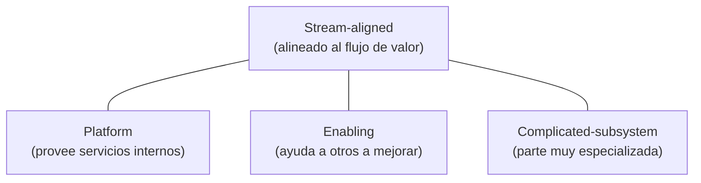

# 08 · Equipos, personas y comunicación (Team Topologies)

> 🧩 **Guía de estudio para llegar a la clase con el tema masticado.**
> Basada en el cronograma de la cátedra (clase 8), el libro base ***Artful Making*** y la **guía de prácticos 4 (Team Topologies)** de la cátedra, resuelta abajo. Lectura previa: resumen de *Team Topologies* (campus).

---

## 🎯 En una frase

El software lo hacen **personas en equipos**, y cómo estén **organizados y comunicados** determina el resultado; **Team Topologies** propone tipos de equipos e **interacciones bien definidas**, y se suma la gestión de **conflictos** y el **diseño de la comunicación**.

---

## 🧭 ¿Por qué importa / dónde encaja?

Porque un buen proceso con un equipo mal organizado igual falla. *Artful Making* pone la **colaboración** en el centro (como un elenco teatral). Esta clase da el marco para diseñar equipos que fluyan y se comuniquen sin fricción — y aparece la **Ley de Conway**, que conecta estructura de equipos con arquitectura del sistema.

---

## 💡 La idea con una analogía

Un equipo de desarrollo es como un **elenco de teatro** (la metáfora de *Artful Making*): funciona cuando cada uno conoce su rol, **ensaya junto** y hay confianza para improvisar. Si en cambio los actores se pasan notas por debajo de la puerta y nunca ensayan juntos, la obra sale desarticulada. **Team Topologies** es el "reparto de roles y escenas" para que la colaboración fluya.

---

## 🗺️ Los tipos de equipo (Team Topologies)

---

## 📊 Conceptos clave

### Team Topologies

| Tipo de equipo | Rol |
| --- | --- |
| **Stream-aligned** | Alineado a un **flujo de valor** (una parte del producto); es el equipo principal |
| **Platform** | Ofrece **servicios/herramientas internas** para que los stream-aligned vayan rápido |
| **Enabling** | **Ayuda** a otros equipos a adquirir capacidades (mentoría técnica) |
| **Complicated-subsystem** | Se encarga de una **parte muy especializada** (ej. un motor de cálculo) |

**Modos de interacción**: colaboración, *X-as-a-Service*, y *facilitating*.

### Personas y comunicación

| Concepto | Idea |
| --- | --- |
| **Gestión de conflictos** | Los conflictos son inevitables; se gestionan, no se evitan |
| **Diseño de la comunicación** | Definir **quién habla con quién y cómo** (reduce ruido y cuellos de botella) |
| **Ley de Conway** | Un sistema tiende a **copiar la estructura de comunicación** de la organización que lo construye |
| **Carga cognitiva** | Un equipo rinde mejor si no está sobrecargado de responsabilidades dispares |

> 🔑 **Ley de Conway (y "maniobra inversa"):** si querés cierta arquitectura, **organizá los equipos** en consecuencia.

---

## 👥 Lo que dio la cátedra (apuntes de 1C 2026)

- **Teoría X vs. Y:**
  - **X:** las personas necesitan control y supervisión.
  - **Y:** son autónomas y automotivadas; la gestión da contexto y apoyo. Es la base de lo ágil.
- **Equipos por componente vs. por funcionalidad:**
  - **por componente:** especialistas → dependencias y cuellos de botella;
  - **por funcionalidad:** multidisciplinarios, entregan de punta a punta.
- **Tamaño y formación:** equipos chicos, alrededor de **7 ± 2** personas. Un grupo tarda **unos 5 sprints** en funcionar como equipo.
- **Alineación + autonomía:** el líder dice **qué** y **para qué**; el equipo decide **cómo**.
- **Liderazgo en Scrum:** el equipo lidera lo técnico, el Scrum Master el proceso y el Product Owner la visión.
- **Estilos de liderazgo:** coercitivo, ejemplar, democrático, mentor, integrador y visionario.
- **Comunicación no violenta:** separar la **observación** de la **evaluación**; evitar "siempre" y "nunca"; no suponer intenciones.

> ⚠️ Los apuntes atribuyen el "7 ± 2" al Manifiesto Ágil, pero **el Manifiesto no habla de tamaño de equipo**. Es una recomendación habitual en Scrum: el Scrum Guide 2020 dice "típicamente 10 o menos".

Detalle en el [Resumen para la Evaluación 1](Resumen%20para%20la%20Evaluaci%C3%B3n%201.md#91-equipos-personas-y-comunicación).

---

## 🧱 La guía de prácticos 4 de la cátedra: Team Topologies

> La cátedra la publicó para esta clase (v1.0, 2C 2026): [PDF](../Teor%C3%ADa/08%20-%20Gu%C3%ADa%20de%20pr%C3%A1cticos%204%20-%20Team%20Topologies.pdf). La referencia obligatoria es la charla de **Manuel Pais**, *Playing Tetris with Cognitive Load* (Codemotion Madrid 2024, 42 min, en inglés). La complementaria, el libro *Team Topologies* (Skelton y Pais) y teamtopologies.com.

### El problema que plantea

- **Lo que mira el resto de la materia:** casi todo (backlog, flujo, métricas, ceremonias) mira la gestión **desde un equipo**.
- **El punto ciego:** un equipo puede hacer **todo bien** y entregar lento igual, porque lo que lo frena **no está adentro**:
  - **de cuántos equipos depende** para publicar un cambio;
  - **cuánto sistema tiene que entender** para tocarlo sin romper nada;
  - **quién decidió** que el límite entre equipos pasara por ahí.
- **Quién decide eso:** son decisiones **sistémicas**, tomadas casi siempre **por fuera** del equipo y muchas veces **por inercia** (el organigrama, la herencia de un proyecto anterior). Evaluar solo desde el equipo es optimizar una pieza **sin mirar la máquina**.
- **La propuesta:** *Team Topologies* toma **la organización de los equipos como objeto de diseño**, apoyada en dos ideas:
  - **Carga cognitiva:** hay un **límite** a lo que un equipo puede entender y sostener a la vez. Si el alcance lo supera, **ninguna ceremonia ni herramienta lo compensa**: aparecen demoras, errores y desgaste. Dimensionar el alcance de un equipo **es** dimensionar su carga.
  - **Tamaño y límites de comunicación:** los grupos **chicos y estables** sostienen confianza y aprendizaje. Al crecer, la comunicación se vuelve cara. Importa cuántas personas hay **y con cuántos otros equipos** hay que coordinarse.
- **Detrás está la ley de Conway:** los sistemas reflejan la estructura de comunicación de quienes los construyen. La estructura de equipos **no es neutral**: "**si no se diseña a propósito, se diseña sola**".

### Lo que hay que saber (objetivos TT-1 a TT-7)

| Código | El alumno debe poder… | En corto |
| --- | --- | --- |
| **TT-1** | Explicar por qué la estructura de equipos es una **decisión de gestión con impacto sistémico** | Mirar solo un equipo es optimizar una pieza sin mirar la máquina |
| **TT-2** | Relacionar comunicación y arquitectura (**Conway**) para razonar fronteras | Si querés cierta arquitectura, diseñá los equipos así (**maniobra inversa de Conway**) |
| **TT-3** | Reconocer la **carga cognitiva**, sus fuentes y efectos, y **acotar el alcance** | Menos dominios por equipo, fronteras claras, plataforma que saque lo accesorio |
| **TT-4** | Relacionar **tamaño** con comunicación y coordinación | Canales = n(n−1)/2: 8 personas → 28; 15 → 105. Equipos de unas 5 a 9 personas |
| **TT-5** | Distinguir los **cuatro tipos de equipo** | *Stream-aligned*, plataforma, habilitador (*enabling*) y subsistema complicado |
| **TT-6** | Distinguir los **tres modos de interacción**, cuándo conviene cada uno y **por qué no son permanentes** | Colaboración (para descubrir; es cara), X-as-a-Service (consumir con poca coordinación) y facilitación (ayudar a aprender) |
| **TT-7** | **Proponer** una organización para un caso **y un camino para llegar** | El destino y también la transición, sin frenar lo que está en curso |

> 🔑 **Los modos de interacción cambian con el tiempo:**
> - la **colaboración** sirve para **descubrir** algo nuevo, pero tiene un costo alto: responsabilidades difusas y más carga y comunicación. Al terminar, se pasa a **X-as-a-Service**;
> - la **facilitación** de un equipo habilitador es **temporal**: su objetivo es **dejar de ser necesario**.

### ✍️ Ejercicios conceptuales resueltos

> Son respuestas propias, armadas con el material de la cátedra. No hay resolución oficial.

**1. Un equipo hace todo bien y su tiempo de entrega es malo. ¿Qué explicaciones quedan fuera de lo que puede ver o decidir solo?**
- **Dependencias:** necesita a otros equipos para publicar (QA central, infraestructura, el dueño de un servicio compartido). El tiempo se va **esperando en colas ajenas**, que su tablero no muestra.
- **Arquitectura acoplada:** para cambiar algo tiene que entender o tocar **partes de otros**, o coordinar despliegues conjuntos.
- **Alcance mal definido:** le asignaron más dominios de los que puede sostener (**carga cognitiva**).
- **Aprobaciones externas:** comités de cambios o revisiones de arquitectura.
- **Fronteras heredadas** del organigrama o de un proyecto anterior.
- **Cómo verlo:** medir el **lead time de punta a punta** separando trabajo de **espera**, y mapear de quién depende cada entrega.

**2. "Primero diseñemos la arquitectura del sistema extendido y después armamos los equipos."**
- **Por qué el orden es engañoso:** por la **ley de Conway**, la estructura de equipos va a moldear la arquitectura igual. Si se diseña la arquitectura y después se reparten equipos sin pensar sus fronteras, el sistema **termina pareciéndose a cómo se comunican esos equipos**, no al diseño.
- **Qué conviene:** diseñar **las dos cosas juntas**, con la **maniobra inversa de Conway**:
  1. Decidir qué **flujos de valor** se quieren independientes (turnos, telemedicina, recordatorios, portal de resultados).
  2. Armar los equipos y las fronteras del sistema **alineados** a esos flujos, cuidando la carga cognitiva.
- **Y sin congelarla:** tampoco conviene diseñar toda la arquitectura de antemano. Va a evolucionar con lo que se aprenda.

**3. Un equipo de 8 no vacía su backlog y le suman 7 personas.**
- **Contras:**
  - los canales de comunicación pasan de **28 a 105**;
  - los que ya están tienen que **incorporar** a los nuevos, y al principio se avanza **más lento** (ley de Brooks: sumar gente a un proyecto atrasado lo atrasa más);
  - se pierden la confianza y el aprendizaje de un grupo chico (la cátedra habla de unos **5 sprints** para que un grupo funcione como equipo);
  - **la carga cognitiva no baja**: el backlog sigue mezclando lo mismo.
- **Alternativa:**
  - primero entender **por qué** no se vacía: ¿hay demasiado trabajo en curso? ¿esperas por dependencias? ¿demanda sin priorizar?;
  - si hace falta más capacidad, **partir en dos equipos chicos** con **fronteras claras** por flujo de valor, cada uno con **su** parte del backlog;
  - sumar a la gente **de a poco**.

**4. La plataforma hizo una herramienta excelente y nadie la usa.**
- **Lo que faltó:** tratar la plataforma **como un producto** y a los demás equipos **como sus clientes**. Es el bloque de producto aplicado adentro:
  - **descubrir** qué necesitaban (entrevistas, observar cómo despliegan hoy, **tests de usabilidad**);
  - empezar con **un equipo piloto en modo colaboración** para diseñarla juntos;
  - pasar después a **X-as-a-Service** con autoservicio, buena documentación y uso fácil;
  - si cuesta adoptarla, ofrecer **facilitación**;
  - **medir la adopción** y empezar por la **plataforma más fina viable**, no por la "técnicamente excelente".

**5. Dos equipos colaboraron 6 meses, les fue bien, ahora van más lento y quieren "seguir como hasta ahora".**
- **Qué está pasando:** la **colaboración** es un modo **temporal**, para descubrir algo nuevo juntos. Su costo es alto: responsabilidades difusas, más reuniones, más carga cognitiva porque cada uno tiene que entender lo del otro. Ya cumplió su objetivo (lanzar la funcionalidad), así que ahora **solo queda el costo**.
- **Qué propondría:**
  - definir **quién es dueño** de la funcionalidad compartida;
  - que ese equipo la ofrezca **como servicio** (X-as-a-Service) con una interfaz clara, su "API de equipo";
  - **revisar** periódicamente los modos de interacción;
  - **medir** lead time antes y después.

**6. Un equipo de arquitectura aprueba todos los diseños desde hace años y se presenta como "habilitador".**
- **No coincido:**
  - un equipo **habilitador** ayuda a otros a **adquirir capacidades** en modo **facilitación**, por un **tiempo acotado**, y busca **dejar de ser necesario**;
  - este equipo hace lo contrario: es un **control de paso** (*gatekeeper*) **permanente**. Genera **dependencia, colas y esperas**, y saca autonomía a los equipos (alineación sin autonomía).
- **Para que sea habilitador de verdad:**
  - pasar de **aprobar** a **enseñar y acompañar**, con intervenciones acotadas;
  - publicar **guías y decisiones** de arquitectura;
  - capacitar a los equipos para que **decidan solos**;
  - eventualmente, distribuir arquitectos **dentro** de los equipos *stream-aligned*.

### ✍️ Ejercicios situacionales resueltos (Centro de Salud Norte, un año después)

**El caso:**
- **De dónde viene:** el sistema de turnos se extiende a **tres sedes**, con telemedicina, recordatorios por WhatsApp y un portal de resultados. Tecnología pasó de **6 a 40 personas**.
- **Los equipos de hoy:**
  - **Turnos** (9): web de pacientes, app, recordatorios, agendas de recepción y de profesionales, y normativa de datos de salud;
  - **Padrón** (5): integración con el padrón de pacientes, que **todos** necesitan;
  - **Reportes:** tableros para la dirección;
  - un grupo de **infraestructura** y uno de **QA** que atienden a todos.
- **El síntoma:** los tiempos de entrega crecieron, pero **cada equipo, mirado por separado, tiene buenas métricas**.

**1. Alcance del equipo de Turnos** (9 personas, backlog mezclado, cada vez más lento, con rotación).
- **Veo este posible problema:** **carga cognitiva** excesiva.
  - Son **cinco dominios distintos** más la normativa, con cambios de contexto todo el tiempo.
  - El backlog mezcla prioridades que no se pueden comparar.
  - El equipo está en el **límite de tamaño**.
  - La **rotación** es un síntoma de desgaste.
- **Propongo organizar el alcance así:**
  - partir en **dos equipos *stream-aligned*** de 4 o 5 personas, alineados a **flujos de valor**:
    - **"Experiencia del paciente":** web, app y recordatorios;
    - **"Agendas":** recepción y profesionales;
  - para la **normativa de datos de salud**, un **habilitador temporal** (o especialistas) que **facilite** a los dos equipos hasta que la incorporen. Lo que sea repetible (consentimientos, auditoría), ofrecerlo **como servicio** de la plataforma.
- **Sabremos si mejoró si observamos** (con **GQM**: el objetivo es entregar más rápido sin desgastar al equipo):
  - menor **lead time** por equipo;
  - mayor **frecuencia de despliegue** sin más **fallas** (DORA);
  - **menos esperas** entre equipos;
  - menos rotación;
  - una **encuesta de carga percibida**.

**2. Dependencia de Padrón** (cola de seis semanas, "el equipo más ocupado"; la dirección propone sumar 3 personas y que cada equipo "coordine directo").
- **Análisis:**
  - Padrón es un **cuello de botella** del que dependen todos. "Más ocupado" no es "más productivo": con la utilización al tope, **las colas crecen** (lo mismo que se ve en Kanban).
  - **Sumar 3 personas** no cambia la estructura y suma costo de incorporación.
  - **"Que cada uno coordine directo"** **multiplica** los canales de comunicación y las negociaciones. No hay una única prioridad, Padrón se vuelve una **mesa de pedidos** y gana el que más presiona.
- **Cómo lo organizaría:**
  - que Padrón funcione como **plataforma**: una **API de autoservicio** del padrón (consultas, altas, validaciones), consumida en modo **X-as-a-Service**, para que los equipos **no tengan que pedir**;
  - lo realmente complejo de la integración, encapsulado como **subsistema complicado** con interfaz clara;
  - **un único backlog priorizado** con un responsable de producto;
  - **colaboración temporal** con el equipo más dependiente para diseñar la API;
  - **trabajo en curso limitado** y la cola **visible**.
- **Cómo medirlo:**
  - el tiempo de espera de los pedidos;
  - **cuántas entregas de otros equipos necesitan a Padrón**: tiene que bajar.

**3. Reorganización en grupos de Frontend, Backend, Datos y QA** ("para aprovechar la especialización").
- **No coincido:**
  - son **equipos por componente**: cada funcionalidad cruza **cuatro grupos**;
  - eso trae **pases de mano**, dependencias, esperas y **nadie dueño del valor de punta a punta**;
  - con QA al final, el feedback llega tarde;
  - por **Conway**, el sistema va a quedar partido **en capas acopladas**.
- **Alternativa:**
  - **equipos *stream-aligned* multidisciplinarios** (con front, back, datos y testing adentro), uno por flujo de valor: turnos y agendas, telemedicina, portal de resultados, comunicación con pacientes;
  - **un equipo de plataforma** (infraestructura, CI/CD, la API del padrón);
  - **habilitadores temporales** (automatización de pruebas, datos, normativa) que **facilitan** en vez de hacer el trabajo de los demás;
  - **subsistema complicado** solo si hay algo realmente especializado.
- **Transición sin frenar lo que está en curso:**
  1. Hacerla **de a poco**, empezando por **un equipo piloto**. Telemedicina, que es nuevo, no rompe nada.
  2. **Terminar los compromisos en curso** antes de mover gente.
  3. Dejar **explícitas las APIs de equipo** y los modos de interacción.
  4. **Medir** antes y después.
  5. Evitar reorganizar seguido: un equipo tarda en consolidarse.

---

## ❓ Preguntas para autoevaluarte

1. Nombrá los **cuatro tipos de equipo** de Team Topologies y qué hace cada uno.
2. ¿Qué dice la **Ley de Conway**? Dame un ejemplo.
3. ¿Por qué conviene **diseñar la comunicación** en vez de dejarla librada al azar?
4. ¿Qué es la **carga cognitiva** de un equipo y por qué importa?
5. ¿Cómo conecta esto con la metáfora del **elenco** de *Artful Making*?
6. ¿Por qué los **modos de interacción** no son permanentes? ¿Qué pasa si la colaboración se estira?
7. ¿Por qué un equipo de arquitectura que aprueba todo **no** es un equipo habilitador?
8. Un equipo de 8 recibe 7 personas más: ¿cuántos canales de comunicación tenía y cuántos tiene?

---

## 📌 Qué prestar atención en la clase

- Los **tipos de equipo** y **modos de interacción**.
- La **Ley de Conway** (estructura de equipos ↔ arquitectura del sistema).
- Herramientas de **gestión de conflictos** y **diseño de flujos de comunicación**.
- Es semana de **feriado**: hay material y **guía de prácticos 4** en el campus para trabajar.

---

⚙️ Guía basada en el cronograma de la cátedra, *Artful Making* (Austin & Devin) y la *Guía de Práctico: Team Topologies* v1.0 de la cátedra (2C 2026). Las respuestas de los ejercicios son propias.
