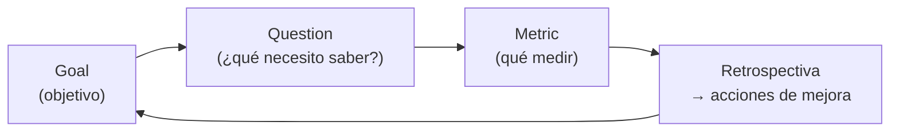
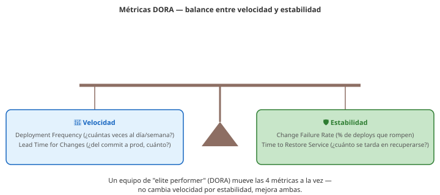

# 09 · Mejora y métricas

> 🧩 **Guía de estudio para llegar a la clase con el tema masticado.**
> Basada en el cronograma de la cátedra (clase 9) y el libro base ***Artful Making***. Lecturas previas: *Construcción de Software* (Retrospectivas) · DORA / Nicole Forsgren.

---

## 🎯 En una frase

Mejorar el proceso de forma sostenida requiere **mirar datos, no impresiones**: las **retrospectivas** generan acciones de mejora, **GQM** conecta objetivos con métricas, y las métricas **DORA** miden el rendimiento de entrega de software.

---

## 🧭 ¿Por qué importa / dónde encaja?

Cierra el bloque **Producto** con la idea de **mejora continua**: no alcanza con entregar, hay que **aprender a entregar mejor**. Conecta con *Artful Making* (ensayar y ajustar) y anticipa el bloque de **Procesos** (Kanban, Toyota Kata). Es la última clase antes de la **Evaluación 1** (lunes 26/10, la clase siguiente), donde también se entrega la **v3** (plan de mejora).

---

## 💡 La idea con una analogía

Mejorar sin métricas es como **entrenar para una maratón sin cronómetro ni GPS**: sentís que corrés más rápido, pero no sabés. Las métricas son el **reloj y el pulsómetro**: te dicen dónde estás y si vas mejorando. Pero ojo: si medís **lo que no importa**, entrenás para el número equivocado — por eso **GQM** parte del **objetivo** antes de elegir qué medir.

---

## 🗺️ De objetivo a métrica (GQM) y el ciclo de mejora

---

## 📊 Conceptos clave

### Retrospectivas

Reunión donde el equipo mira **cómo trabajó** (no el producto) y define **acciones concretas** de mejora. Pilar de la mejora continua ágil.

### GQM (Goal – Question – Metric)

Método para **no medir por medir**: primero el **objetivo**, después las **preguntas** que ayudarían a saber si lo cumplís, y recién ahí las **métricas**.

### Métricas DORA (Nicole Forsgren)

| Métrica | Qué mide |
| --- | --- |
| **Deployment Frequency** | Con qué frecuencia se despliega a producción |
| **Lead Time for Changes** | Cuánto tarda un cambio de commit a producción |
| **Change Failure Rate** | Qué % de despliegues causa fallas |
| **Time to Restore Service** | Cuánto se tarda en recuperarse de un incidente |

> ⚠️ **Cuidado con las métricas:** una métrica mal elegida se vuelve un objetivo que se "juega" (Ley de Goodhart: *"cuando una medida se vuelve objetivo, deja de ser buena medida"*). Por eso DORA balancea **velocidad** (frequency, lead time) con **estabilidad** (failure rate, restore).

### DORA como balanza: velocidad ↔ estabilidad

---

## 📊 Lo que dan las slides de la cátedra (clase 8, 2C 2025)

- **Mejora:**
  - *"Si no estás mejorando cómo hacés tu trabajo, no estás haciendo tu trabajo"* (Tom Peters).
  - **Razones:** todo empeora solo, no todo sale natural, los valores están por encima de la práctica, hay que adaptarse y siempre hay algo por aprender.
  - **Ciclos:** PDCA y *Heart of Agile*.
  - **Objetos de mejora:** procesos y prácticas, equipo, herramientas, producto, dirección, organización y consciencia.
  - **Kaizen** (continua, pasos chicos) vs. **kaikaku** (radical).
  - **7 desperdicios** (Poppendieck): trabajo en progreso, funcionalidades extras, reaprendizaje, traspasos, cambio de contexto, demoras y defectos.
- **Métricas:**
  - "Deben ser medidas de **realidad**, no de éxito o fracaso" (Tobias Mayer).
  - **Métrica** = definición formal de la variable · **medición** = el acto de tomar valores · **indicador** = su representación visual.
  - **Elementos de una métrica:** nombre, escala, valor más positivo, forma de medición y estadístico de agregación.
  - **GQM:** objetivo → preguntas → métricas.
- **Retrospectiva:**
  - **Propósito:** analizar una situación, detectar causas y establecer compromisos de mejora.
  - **Estructura:** ingreso → recolección de datos → priorización y análisis → propuestas y compromisos → salida.
  - **Técnicas:** línea de tiempo, 5 porqués, agrupamiento temático.
  - **Compromisos:** seleccionar uno, sacrificio rotativo, "alguien siempre hace progreso".
- **Toyota Kata** (Rother):
  - **Improvement Kata:** desafío → condición actual → siguiente condición objetivo → experimentos.
  - **Coaching Kata:** el gerente como coach.
  - Tiene preguntas fijas para **planificar** (6) y para **revisar** (4) un experimento.

Detalle completo en el [Resumen para la Evaluación 1](Resumen%20para%20la%20Evaluaci%C3%B3n%201.md#92-mejora-y-métricas-).

---

## ❓ Preguntas para autoevaluarte

1. ¿Qué se mira en una **retrospectiva** y qué la distingue de un review?
2. ¿Qué orden propone **GQM** y por qué **no** se empieza por la métrica?
3. Nombrá las **4 métricas DORA** y qué equilibran (velocidad vs. estabilidad).
4. ¿Por qué una métrica mal elegida puede ser **contraproducente**?
5. ¿Cómo se conecta la mejora continua con *Artful Making*?

---

## 📌 Qué prestar atención en la clase

- Cómo una **retrospectiva** produce **acciones de mejora** (no solo quejas).
- La lógica **GQM** (objetivo → pregunta → métrica).
- Las **4 métricas DORA** y el balance velocidad/estabilidad.
- ⚠️ La clase siguiente (26/10) es la **Evaluación 1 (Producto)** y la **entrega v3 (plan de mejora)**. Para prepararla: [Resumen para la Evaluación 1](Resumen%20para%20la%20Evaluaci%C3%B3n%201.md).

---

⚙️ Guía basada en el cronograma de la cátedra y *Artful Making* (Austin & Devin).
