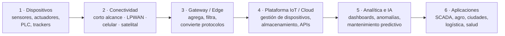
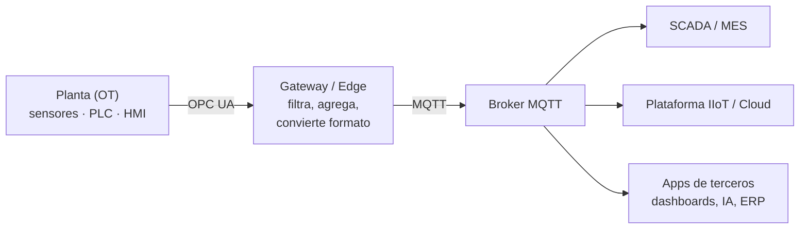

# 13 · IoT y redes industriales (IIoT)

> 🧩 **Guía de estudio para llegar a la clase con el tema masticado.**
> Basada en la PPT de la clase **#12 BIS** de la cursada 2026 (*IOT & Redes Industriales (+ IIOT)*), guardada como `13` en la carpeta de PPTs. Varias láminas son infografías: se leyeron como imagen.
> Es tema **posterior al primer parcial**: entra en el **final**.

---

## 🎯 En una frase

**IoT** es conectar objetos físicos (sensores, medidores, máquinas) a una red para **medir, intercambiar datos y actuar**. En la industria se llama **IIoT** y suma una exigencia nueva: la red no solo informa, **controla procesos físicos**. Por eso necesita **disponibilidad, baja latencia y determinismo**, y protocolos propios: Modbus, HART, PROFINET, OPC UA y MQTT.

---

## 🧭 ¿Por qué importa / dónde encaja?

- **Junta casi todo lo visto en la materia:**
  - medios físicos (cobre, fibra, inalámbrico: guías 04 y 05);
  - topologías (guía 01);
  - Ethernet y VLAN (guía 07);
  - TCP/IP y puertos (guías 08 y 11);
  - protocolos de aplicación y seguridad (guía 12);
  - **edge y cloud** (guía 10).
- **La idea central es la convergencia IT/OT:** que la red de la planta (OT) y la red de la empresa (IT) dejen de ser mundos aislados.
- **En los apuntes de cursadas anteriores** aparece como tema **de final**: la diferencia entre **LoRa y LoRaWAN**, **5G vs. LoRaWAN** e **IoT vs. IIoT**.

---

## 💡 La idea con una analogía

Una planta industrial es como un **cuerpo humano**:
- los **sensores** son los sentidos;
- los **actuadores** (válvulas, motores) son los músculos;
- el **PLC** es la médula espinal, que decide **rápido y sin pensar** (los reflejos);
- el **SCADA** es la parte del cerebro que **mira todo** y deja que una persona intervenga;
- el **ERP** es la "mente" que planifica a largo plazo.

Un reflejo **no puede llegar tarde**: si la mano toca algo caliente, la orden de retirarla tiene que llegar siempre en el mismo tiempo. Eso es el **determinismo** que exige una red industrial y que una red de oficina no garantiza.

---

## 🗺️ Arquitectura IoT de punta a punta (PPT)

> Todo el recorrido necesita **seguridad y gestión de extremo a extremo**:
> - identidad y cifrado de los dispositivos;
> - segmentación de la red;
> - integridad y respaldo de los datos;
> - actualizaciones remotas (OTA).
>
> Los **datos de campo** suben hacia la nube y las **acciones** (control, alarmas, optimización) bajan.

---

## 📊 Conceptos clave

### IoT, IIoT y cómo elegir la tecnología 🔴

| Concepto | Qué es |
| --- | --- |
| **IoT** | Conectar y **monitorear** objetos |
| **IIoT** | Conectar y **optimizar procesos industriales** (supervisión, automatización) |
| **LPWAN** | Conectar **muchos** dispositivos con **bajo consumo** y **gran alcance** |
| **Edge computing** | Procesar los datos **cerca** de los dispositivos, antes de mandarlos a la nube |
| **Cloud computing** | Almacenar, analizar e integrar datos **a gran escala** |

**Criterios para elegir:**
- alcance y cobertura;
- consumo de energía;
- velocidad y volumen de datos;
- latencia;
- costo;
- confiabilidad y seguridad.

> 🔑 **No existe una tecnología IoT que sirva para todo.** Se elige **según lo que pide la aplicación**, no por la velocidad máxima:
> - un **sensor de humedad** que manda un dato cada 15 minutos necesita poquísimo ancho de banda y dura **años con una batería** (LPWAN);
> - una **cámara industrial** necesita capacidad (Wi-Fi, Ethernet o 5G);
> - un **control de movimiento** necesita una red **determinística** (PROFINET RT/IRT).

### Las redes de IoT (PPT)

| Familia | Tecnologías | Para qué |
| --- | --- | --- |
| **Corto alcance** | Bluetooth LE · Zigbee · Thread · Wi-Fi | Hogares inteligentes, sensores y edificios |
| **LPWAN** (largo alcance, bajo consumo) | **LoRaWAN** · **Sigfox** · NB-IoT · LTE-M | Sensores distribuidos, telemetría, agro, ciudades inteligentes, monitoreo remoto |
| **Celulares** | 4G LTE · 5G · LTE Cat-1 | Más capacidad, movilidad, video, gateways |
| **Satelital** | Satélites IoT · NTN | Zonas rurales, remotas, marítimas o sin infraestructura terrestre |

**LoRa vs. LoRaWAN** 🔴 (pregunta de final en los apuntes):
- **LoRa** es la **modulación de radio**, la capa física: usa *Chirp Spread Spectrum* (CSS).
- **LoRaWAN** es el **protocolo y la arquitectura de red** que usa LoRa para conectar dispositivos con **gateways** y **servidores**.
- **Redes:** LoRaWAN permite armar una red **privada** o usar una **pública**.
- **Sigfox, en cambio,** es una conectividad **administrada por operadores**, pensada para mensajes **muy chicos** con bajo consumo.

**5G vs. LoRaWAN** (según los apuntes de cursadas anteriores):
- **5G:** alta capacidad y velocidad, en frecuencias **licenciadas**.
- **LoRaWAN:** ráfagas chicas de datos, baterías que duran **años**, frecuencias **no licenciadas** y zonas remotas.

### IT y OT: dos mundos que convergen

| | **IT** | **OT** |
| --- | --- | --- |
| Qué maneja | Información, aplicaciones, usuarios y datos corporativos | **Monitoreo y control de procesos físicos** |
| Si falla… | Se pierde información o servicio | **Se para la producción** o hay riesgo físico |

- **Qué es la convergencia:** usar los **datos operacionales** para tomar mejores decisiones.
- **Qué no es:** ⚠️ **no implica que todo deba conectarse directamente a Internet**.

**Lo que exige una red industrial:**
- **disponibilidad** y recuperación ante fallas (redundancia);
- **latencia y jitter** adecuados a la aplicación;
- **determinismo** cuando el control lo requiere;
- robustez **electromagnética** y ambiental;
- diagnóstico, mantenimiento y ciclo de vida.

### Topologías y medios en planta

| Topología | Pro / contra |
| --- | --- |
| **Estrella** | Simple de administrar, pero **depende del equipo central** |
| **Línea / bus** (*daisy chain*) | Sencilla, pero si se corta un tramo **se pierden todos los equipos de más abajo**. Cuidar fallas y terminaciones |
| **Anillo** | Puede ofrecer **redundancia**: con **MRP** (*Media Redundancy Protocol*), si se corta un tramo el tráfico **vuelve por el otro lado** |
| **Malla** | Múltiples caminos, más complejidad |

**Medios físicos:**
- **cobre Ethernet**, práctico para enlaces de planta;
- **fibra**, por distancia, **aislamiento eléctrico** e inmunidad a **EMI**;
- **RS-485**, frecuente en buses serie industriales;
- **Wi-Fi / 5G**, para movilidad.

**Ethernet industrial:**
- es la base física y de enlace;
- los **switches industriales** soportan temperatura, vibración y alimentación especial;
- las **VLAN** segmentan el tráfico;
- la calidad de servicio y la redundancia **dependen del diseño**.

### Automatización industrial

**El lazo de control:** **sensor (mide) → PLC/DCS (decide) → actuador (actúa)**, con una **HMI** que presenta la información al operador. Como el proceso se realimenta, se habla de **proceso continuo**.

| Pieza | Qué es |
| --- | --- |
| **PLC / DCS** | Controlador programable / sistema de control distribuido |
| **HMI** | Interfaz de operador |
| **SCADA** | Supervisión y adquisición de datos |
| **Historiador** | Guarda **series temporales** y eventos |
| **Gateway** | Traduce o agrega protocolos |

**La evolución:**
1. Control **neumático** (presión de aire).
2. Control **eléctrico** (relés, contactores, lógica cableada).
3. Instrumentación **analógica** (señal **4–20 mA**, controladores PID).
4. Instrumentación **digital de campo** (**HART** sobre 4–20 mA).
5. **Buses** industriales (Modbus RTU, RS-485, PROFIBUS, Foundation Fieldbus).
6. **Ethernet industrial y TCP/IP** (Modbus TCP, PROFINET, EtherNet/IP, OPC UA).
7. **IIoT** e integración empresarial (gateways, MQTT, edge, MES, ERP).

### El modelo de capas de una planta 🔴

| Nivel | Qué hay |
| --- | --- |
| **5 · Empresa** | ERP, BI, planificación, finanzas |
| **4 · Operaciones** | **MES**, calidad, mantenimiento (CMMS) |
| **3 · Supervisión** | **SCADA**, HMI |
| **2 · Control** | **PLC**, PAC, DCS |
| **1 · Campo** | **Sensores y actuadores** |

> Igual que el modelo OSI ordena una red de datos, este modelo ordena una red industrial: **de abajo arriba** los datos se van agregando y ganan contexto de negocio.

### Protocolos industriales 🔴

| | **Modbus** | **HART** |
| --- | --- | --- |
| Origen | Modicon, **1979** | *Highway Addressable Remote Transducer* |
| Qué es | Protocolo digital para comunicar PLC, sensores, medidores, variadores y SCADA | Protocolo digital para **instrumentación inteligente** |
| Cómo funciona | **Cliente-servidor**: el cliente pide o escribe datos y el servidor responde. En serie se llamaba **maestro-esclavo** | Superpone una señal digital **FSK** sobre el lazo analógico **4–20 mA**, sin alterar su valor promedio |
| Variantes / modos | **RTU** (serie, RS-485 o RS-232) · **ASCII** (serie, en caracteres) · **TCP** (Ethernet, **puerto 502**) | **Punto a punto:** conserva la señal analógica · **Multidrop:** varios instrumentos en un segmento, con la analógica fija en su mínimo |
| Qué transmite | Estados digitales, valores analógicos, parámetros y consignas | El 4–20 mA lleva la **variable de proceso**. Lo digital lleva identificación, **diagnóstico** y configuración |
| Ventajas | **Simple, económico, abierto**, muy compatible | Diagnóstico y configuración remota **sin cambiar la infraestructura analógica** |
| Limitaciones | ⚠️ **Sin autenticación ni cifrado** propios: necesita medidas de ciberseguridad. Lo serie es lento | Poco ancho de banda digital. Requiere equipos compatibles |

> **Modbus y HART no se excluyen:** pueden convivir en una misma planta. Para llevarlos al **IIoT**:
> - un **gateway** puede convertir Modbus a **MQTT**;
> - un sistema de gestión de activos puede extraer los diagnósticos HART.

**PROFINET** (*Process Field Network*):
- **Qué es:** un protocolo industrial **sobre Ethernet**, para datos de control **en tiempo real** entre PLC, E/S remotas, variadores, servos y robots.
- **Las variantes:**
  - **PROFINET RT:** comunicación **determinística**, con ciclos típicos de **ms**;
  - **PROFINET IRT:** **isócrona y sincronizada**, con ciclos **< 1 ms** para alta precisión.
- **Las topologías:** línea, estrella, árbol y **anillo con MRP**.

**Ethernet + TCP/IP frente a Ethernet + PROFINET** (tabla de la PPT):

| | Ethernet + TCP/IP | Ethernet + PROFINET |
| --- | --- | --- |
| Uso | Oficina, Internet, aplicaciones IT | Automatización industrial |
| Capas | 2 (Ethernet, MAC) · 3 (IP) · 4 (TCP/UDP) | 2 (**PROFINET RT**, EtherType **0x8892**) · 4 (TCP/UDP **solo para lo acíclico**) · 7 (aplicación) |
| Determinismo | **No**: el tiempo de entrega varía | **Sí**: RT en ms, IRT < 1 ms |

> 🔑 **El truco de PROFINET RT:** los datos de control cíclicos **no pasan por IP ni TCP**. Van **directo sobre la capa 2**, con su propio EtherType. Se saltean el procesamiento de las capas 3 y 4, y por eso el tiempo es predecible. IP y TCP/UDP quedan para servicios complementarios (configuración, diagnóstico).

**MQTT y OPC UA:**

| | **MQTT** | **OPC UA** |
| --- | --- | --- |
| Qué es | Mensajería **liviana** con un intermediario, el **broker** | Arquitectura de interoperabilidad industrial **entre fabricantes** |
| Modelo | **Publish / subscribe:** un sensor o PLC **publica** en un **topic**, el broker lo recibe y lo reenvía a los **suscriptos** | **Cliente / servidor** (y también pub/sub): el servidor expone el equipo y el cliente lee, escribe, recibe notificaciones y consulta alarmas |
| Lo que lo distingue | Bajo ancho de banda, productores y consumidores **desacoplados**, **QoS 0, 1 y 2** | No solo transmite valores: define **qué significan**, su estructura y sus relaciones (modelo **semántico**). **Seguridad integrada** |
| Rol | **Distribuir** telemetría por eventos hacia muchas aplicaciones | **Acceder** a los datos con estructura, significado y contexto |

### La síntesis de la PPT

| Pieza | Para qué sirve |
| --- | --- |
| **Modbus** | Intercambio simple de registros |
| **PROFINET / EtherNet/IP** | Automatización y control |
| **OPC UA** | Interoperabilidad y semántica |
| **MQTT** | Distribución de telemetría por eventos |
| **Wi-Fi / 5G / LoRaWAN** | Conectividad según alcance y consumo |
| **Edge** | Procesamiento local, filtrado y conversión de protocolos |
| **Cloud / IIoT** | Análisis histórico, optimización e IA |

**Ciberseguridad en OT:**
- **segmentar** la red de planta;
- **limitar** los accesos;
- **proteger** las comunicaciones entre la planta y los sistemas corporativos.

### Ejemplo: mantenimiento predictivo

| Paso | Qué es |
| --- | --- |
| **Problema** | Fallas **no planificadas** en motores |
| **Datos** | Vibración, temperatura, corriente y horas de uso |
| **Análisis** | Tendencias, umbrales o un modelo predictivo |
| **Acción** | Inspección **planificada** antes de la falla |
| **KPI** | Paradas, **MTBF** (tiempo medio entre fallas), **MTTR** (tiempo medio de reparación) y costo de mantenimiento |

---

## ⚠️ Ojo con la PPT

| Dónde | Qué dice | Lo correcto |
| --- | --- | --- |
| Láminas 18 a 21, título "Profinet y **Ethernet IP**" | La tabla compara **Ethernet + TCP/IP** con PROFINET | **EtherNet/IP** (con barra) **no** es "Ethernet + IP": es otro **protocolo industrial**, de ODVA y Rockwell, que lleva el protocolo **CIP** sobre Ethernet y TCP/UDP. Es un **competidor** de PROFINET (por eso la lámina de síntesis los pone juntos: "PROFINET / EtherNet/IP") |

---

## ❓ Preguntas para autoevaluarte

1. ¿Qué diferencia hay entre **IoT** e **IIoT**?
2. ¿Qué criterios usás para elegir una tecnología IoT? Para un sensor de humedad que transmite cada 15 minutos, ¿qué elegirías y por qué?
3. Diferenciá **LoRa** de **LoRaWAN**. ¿En qué se diferencia Sigfox?
4. Compará **5G** con **LoRaWAN** para IoT.
5. ¿Qué es **IT** y qué es **OT**? ¿La convergencia implica conectar todo a Internet?
6. Nombrá cuatro **exigencias** de una red industrial. ¿Qué es el **determinismo**?
7. ¿Qué topología conviene si no se puede perder la conexión, y qué protocolo de redundancia se usa?
8. Ordená el **modelo de capas** de una planta, de campo a empresa.
9. Compará **Modbus** con **HART**: cómo funciona cada uno y sus limitaciones.
10. ¿Por qué PROFINET RT es determinístico y Ethernet + TCP/IP no?
11. Diferenciá **MQTT** de **OPC UA**. ¿Cómo se combinan en una arquitectura IIoT?
12. ¿Qué es el **edge computing** y por qué importa en IoT?

---

## 📌 Qué prestar atención en la clase

- **LoRa vs. LoRaWAN** e **IoT vs. IIoT**: aparecen como preguntas de final en los apuntes de cursadas anteriores.
- La **elección de la tecnología según la aplicación** (consumo, alcance, volumen y latencia).
- **El modelo de capas de planta** y la convergencia **IT/OT**.
- La tabla **Modbus vs. HART** y por qué **PROFINET** es determinístico.
- El rol de **OPC UA** (semántica) y **MQTT** (distribución) en la síntesis.

---

⚙️ Guía basada en la PPT de la clase #12 BIS de la cursada 2026, *IOT & Redes Industriales (+ IIOT)* (Volpi / Giorgi / Llasat), incluidas sus infografías. Las preguntas de final salen de los apuntes de cursadas anteriores guardados en `Material extra/`.
